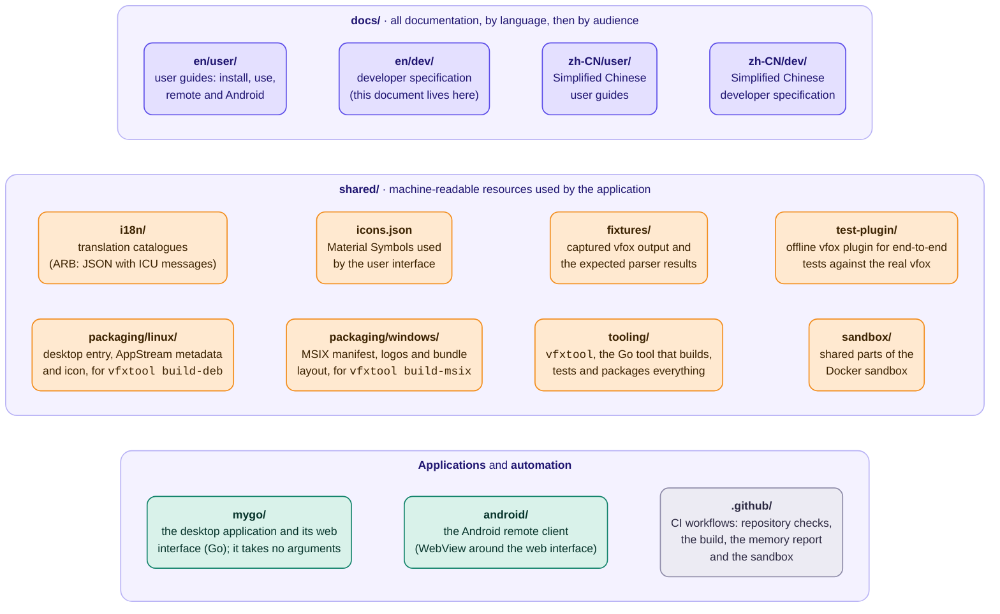
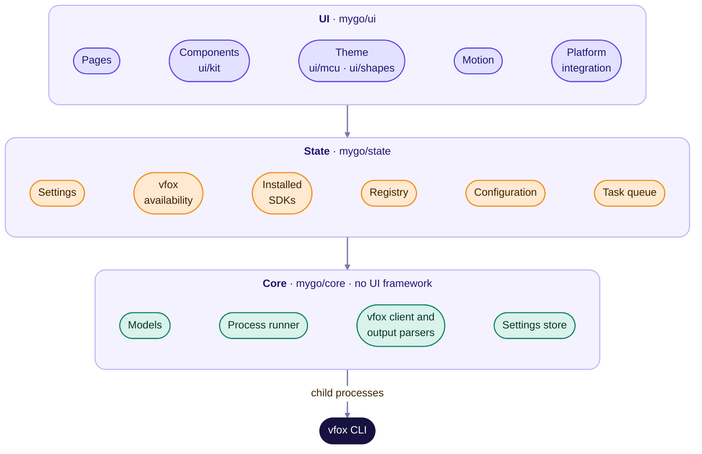
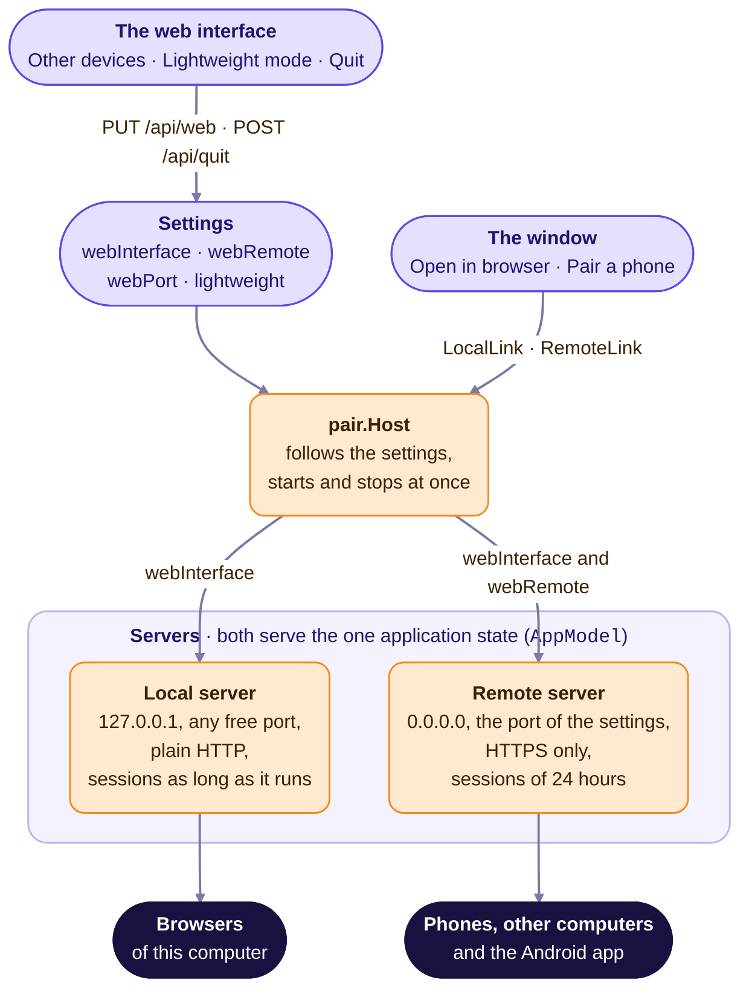

# Architecture

> [简体中文](../../zh-CN/dev/architecture.md)

vfox-plus is a graphical front end for the [vfox](https://vfox.dev) command
line tool. It is built with [mygo](https://github.com/egoist/mygo), the
desktop application framework for Go, and its native user interface: no web
view, no HTML, no JavaScript. mygo draws the window itself, from elements that
are laid out with flexbox and painted with its own renderer, and opens it
through GTK 3 without a C compiler.

## Repository layout

The application reads the shared resources from `shared/` and never copies
them, so that a translation or a fixture is changed in one place only.

## Layers

The application is organised in three layers. Dependencies only point
downwards.

**Core** is plain Go without a UI framework. It contains:

- the domain models (`InstalledSdk`, `PluginInfo`, `AvailablePlugin`,
  `AvailableVersion`, `ConfigEntry`, `UseScope`);
- a *process runner* interface with one implementation based on the platform's
  process API; tests use a scripted fake, and a future remote back end (see
  below) can provide another one;
- the *vfox client*, which builds command lines, runs read-only queries and
  parses their output, and describes state-changing operations as *commands*
  (values) instead of running them;
- the *settings store*;
- the *translation catalogues* with their ICU messages (`core/i18n`);
- the *plugin profiles* (`core/profile`), see below.

It is tested against `shared/fixtures`.

**State** turns core results into observable state for the UI. The most
important piece is the *task queue*: every state-changing command (install,
uninstall, use, unuse, add, remove, update) is queued and executed **one at a
time**, because vfox does not lock its data directory. Each task streams the
output of its process, extracts the download progress, keeps a bounded log and
summarises failures. When a task finishes, the installed SDKs are reloaded.

**UI** renders the state, following [the UI specification](ui-spec.md) and
[the design system](design-system.md). Desktop integration (browser, file
choosers, clipboard, accent colour) sits behind a small *platform services*
interface so that UI tests can replace it. The Material 3 Expressive
components live in `ui/kit`, built on mygo's elements and headless widgets;
the colour scheme (`ui/mcu`, a Go port of the Material colour utilities) and
the shapes (`ui/shapes`, a Go port of `androidx.graphics.shapes`) are plain Go
without a UI framework, like `core` and `state`.

In the sources the layers are `mygo/core`, `mygo/state` and `mygo/ui`
(`ui/kit`, `ui/mcu` and `ui/shapes` are part of the UI layer); `core` knows
nothing of the others, and `state` only knows `core`.

## Plugin profiles

vfox lists, installs, selects and removes versions the same way for every plugin,
but the plugins of the version-fox organisation offer more, and none of it shows
in the output of vfox: `vfox search java tem` lists one distribution of Java
where `vfox search java` lists OpenJDK only, `nodejs@24` installs the newest
Node.js 24 and `flutter@stable` the release of a channel, and each plugin reads
environment variables that move its downloads to a mirror and version files such
as `.nvmrc`. Without knowing this, an interface can only offer what every plugin
has in common, which is how the web interface of the first version came to show
the OpenJDK list of Java and nothing else ([#43](https://github.com/version-fox/vfox-plus/issues/43)).

A *profile* (`core/profile`) writes it down, as plain data that the three
interfaces share, for `java`, `nodejs` and `flutter`:

| Part | What it is |
| --- | --- |
| Search | What follows the plugin name in `vfox search`: for `java` the 31 distributions of Foojay and `all` (on Linux for loong64 the Loongnix JDKs instead), with the one vfox uses without an argument |
| Shorthands | Names that `vfox install <plugin>@<name>` accepts besides the listed versions |
| Variables | The environment variables the plugin reads, with the mirrors that were checked, and what each takes (an `http://` or `https://` address, or one of a few values) |
| Version files | The files vfox reads through the plugin, and whether the vfox setting `legacyVersionFile.strategy` matters for them |
| Facets | The filters that suit the notes and the names of the listed versions: `LTS`, `JavaFX`, the channels and the architectures of Flutter |
| Naming | How a version name is put together, so that `21.0.12.1+1-tem` shows Temurin and `3.47.7-x64` shows x64 |
| Guide, tips, docs | A few sentences on the names, the things that surprise people and links to the documentation of the plugin |

The texts of a profile are written in both languages next to the data, not in
the catalogues, because the web interface gets them over HTTP and the page does not
carry the catalogues. A plugin without a profile behaves as before.
A profile belongs to the plugin, whatever name vfox knows it by. vfox calls a plugin
that was added with `vfox add --alias` by the alias, and `vfox info` still says which
plugin it is, so the controller of the details looks the profile up by the name of the
plugin first and, when that has none, by the name that the information reports once it
has loaded (the page of the details shows the options tab at that moment, and the web
API waits for the information). The registry is `state.AppModel.Profiles`; the
end-to-end tests register a profile for their offline test plugin.

`SdkDetailController` carries the chosen search and the chosen facets. `SetSearch`
forgets the earlier list and the facets (the list loads when somebody asks for it);
`ChooseSearch` is the same for a choice of the user and also hands it to a
`SearchMemory`, which `AppModel` implements with the `searches` setting, so that the
choice survives the details and a restart and is the same in every interface; the
controller starts at the choice that the memory holds, when the profile still offers
it. `AppModel.SetPluginVariable` checks a value against its variable and stores it in
the extra environment of the settings, which every vfox process runs with.

## Talking to vfox

The GUI never reads or writes vfox's files directly; everything goes through the
command line, as described in [the CLI contract](vfox-cli-contract.md). This
keeps the GUI correct across vfox releases and lets vfox keep its invariants.
The contract also lists the quirks of the current vfox output that parsers must
cope with.

Read-only queries run concurrently and are cheap (about 10 ms each); only
`vfox search` and `vfox available` may touch the network.

## Settings

Settings of the GUI itself are stored as JSON:

- on Linux, `$XDG_CONFIG_HOME/vfox-plus/settings.json` (by default
  `~/.config/vfox-plus/settings.json`);
- on Windows, `%APPDATA%/vfox-plus/settings.json`.

| Key                | Type            | Default      | Meaning                                                    |
| ------------------ | --------------- | ------------ | ---------------------------------------------------------- |
| `theme`            | string          | `"system"`   | `system`, `light` or `dark`.                               |
| `useSystemColor`   | boolean         | `true`       | Derive the colours from the desktop accent colour.         |
| `seedColor`        | integer (ARGB)  | `0xFFF28C1B` | Seed colour when the accent colour is not used.            |
| `language`         | string          | `"system"`   | `system`, `english` or `simplifiedChinese`.                |
| `vfoxExecutable`   | string          | absent       | Path of vfox; absent means "detect".                       |
| `extraEnvironment` | object          | `{}`         | Extra environment variables for vfox, e.g. mirrors.        |
| `railExpanded`     | boolean         | `false`      | Whether the navigation rail shows its labels.              |
| `webInterface`     | boolean         | `false`      | Serve the web interface to the browsers of this computer, on a loopback server, while the application runs. Read from `remoteAccess`, its old name, when absent. |
| `lightweight`      | boolean         | `false`      | Closing the window leaves the application running without it, while the web interface is up. |
| `webRemote`        | boolean         | `false`      | Also let other devices on the network connect, over HTTPS. Only means something while `webInterface` is on. |
| `webPort`          | integer         | absent       | The port that other devices connect to, from 1024 to 65535; absent means 8369. |
| `webCertificate`, `webKey` | string  | absent       | The PEM files of the certificate and the private key that other devices get; absent means a certificate that the application makes for itself. |
| `searches`         | object          | `{}`         | What was chosen to list for a plugin, by its name: `{"java": "tem"}`. The default has no entry. |

Unknown keys must be preserved or ignored, never rejected.

The vfox configuration (proxy, registry, storage directory, …) is **not** part
of these settings: it belongs to vfox and is edited through `vfox config`.

## Locating vfox

If no executable is configured, the GUI searches `PATH`, then the usual install
locations that a desktop launcher's `PATH` often lacks:

- on Linux: `/usr/local/bin`, `/usr/bin`, `~/.local/bin`, `~/bin`,
  `~/.linuxbrew/bin`, `/home/linuxbrew/.linuxbrew/bin` and `/snap/bin`, looking
  for `vfox`;
- on Windows: `%ProgramFiles%/vfox`, `%LOCALAPPDATA%/Programs/vfox`,
  `%LOCALAPPDATA%/Microsoft/WindowsApps`, `~/scoop/shims` and `~/.vfox/bin`,
  looking for `vfox.exe` (`PATH` is split at `;`).

The user can also pick the executable. If vfox is missing or broken, the GUI explains how to install it
and keeps the settings reachable.

## Dependencies

Every runtime dependency must fall in Category A or B of the license
classification of the Apache Software Foundation
(see <https://www.apache.org/legal/resolved>): what the ASF allows in its
products may be used here — permissive licenses (for example Apache-2.0,
MIT, BSD, Unlicense) or weak-copyleft licenses (for example MPL-2.0,
EPL-2.0). Category X (strong copyleft such as GPL and AGPL) is excluded.
Category B dependencies ship under their own license and its conditions
(their notices stay intact and their source stays obtainable); the
application links them unmodified. mygo, the framework of the application, is under the MIT license, and
the Go modules it links are purego under the Apache License 2.0, the text
shaper `go-text/typesetting` under the Unlicense or a BSD license, and the
`golang.org/x` modules under BSD licenses, as is the Go standard library; the
QR encoder `skip2/go-qrcode` (MIT) encodes the pairing link of the settings as a
QR code for the Android app to scan; the
ports in `mygo/ui/mcu` and `mygo/ui/shapes` are of libraries under the Apache
License 2.0 and the MIT license, and their notices ship with the application
([`mygo/NOTICE.txt`](../../../mygo/NOTICE.txt)). The application does not link GTK 3,
GLib, Pango and Cairo, which are under the LGPL: mygo loads them from the system
when it starts, and the package depends on them as declared in
`vfxtool runtask` (`shared/tooling/internal/runtask`). The same goes for
`libayatana-appindicator3`, which draws the tray icon on Linux: mygo loads it when the system has
it, and the package recommends it without depending on it. The application
ships no strong-copyleft (Category X) code; weak-copyleft (Category B)
dependencies, if any, ship under their own license terms. The build tooling
in `shared/tooling` (`vfxtool`, never shipped in the application) additionally
uses `go-github` (the GitHub API for the memory report),
`nfpm` (Debian packaging as a library), `go-licenses` (license classification for
the license collector), `go-getter` (resumable downloads with a checksum, for the
package prefetch and the npm package of the icons), `chromedp` (starts Chrome and speaks the DevTools Protocol for the
measurement of the web heap and the screenshots of the web interface, MIT),
`golang.org/x/image` (the vector rasterizer that draws the
Windows logos, BSD-3-Clause), `golang.org/x/tools` (the parser of the coverage
profiles, BSD-3-Clause) and `golang.org/x/sys` (the Windows calls of
`vfxtool sign-msix`: the token for the elevation, the certificate store;
BSD-3-Clause) and `godbus/dbus` (the session bus, for the stand-in for the host of the tray icons that
the end-to-end tests use, and for what they ask of GNOME Shell; BSD-2-Clause), all Category A. The icons are Material Symbols Rounded by Google (Apache-2.0),
which `vfxtool prepare` cuts out of the npm package `@iconify-json/material-symbols` that
`shared/icons.json` pins: the package is downloaded and checked at build time, never linked,
and only the SVGs of the symbols in use are embedded. The Windows `.msix` and `.msixbundle` need no
additional runtime dependency: the Go executable is self-contained and the
package carries its own logos.
Prefer the platform and the official libraries of a technology over third-party
packages, and document why each dependency is needed next to its declaration.

## Memory

Low memory use is a goal of the project. The application:

- keeps lists lazy (the version list of Node.js alone has close to 900
  entries);
- keeps the newest 500 lines of each finished task in memory (2000 while it
  streams) and forgets finished tasks past 50; a failed task keeps its full
  log on disk, pruned to the newest 20 files;
- ships only the icons it uses (61 symbols, outlined and filled, about 70 KB of SVG, parsed when first drawn);
- stops animations that are not visible, and honours the platform's reduced
  motion setting;
- avoids caching data that vfox can produce again cheaply;
- without its window, tells the system that it does not want the pages of its files for now
  (the resident set falls by 11 MB), and the Go scheduler uses at most four processors, which
  keep caches of memory of their own (see [the memory page](memory.md#the-lightweight-mode)).

[The memory page](memory.md) records what the application uses.

## Remote front ends

The application is a desktop application and has no command line: it takes no arguments, and
what else it does is a matter of its settings. The web interface is one of those things. The
package `mygo/pair` holds its servers, and a `Host` runs them as the settings say; the window
and the pages of the web interface itself both write those settings.

- **The web interface** (`webInterface`) starts the local server on the loopback interface, on a free
  port, over plain HTTP: browsers treat loopback origins as trustworthy, so the session cookie,
  which is always `Secure`, is kept there. The window's *Open in browser* mints a one-time link
  for it in the process (`Host.LocalLink`) and opens it in the browser; the link answers with
  the session cookie and a redirect to `/app`.
- **Other devices** (`webRemote`) start a second server on `0.0.0.0` and the port of the settings, which
  speaks HTTPS only, and which `pair.NewServer` refuses to start without a certificate. The
  certificate is the one of `webCertificate` and `webKey`, or one that the application makes for
  itself next to the settings (`EnsureServerCert`), whose fingerprint the settings show for
  comparison. *Pair a phone* mints a link for it (`Host.RemoteLink`), with an address of the computer
  that the user chooses in it, and draws it as a QR code (`pair.QRMatrix`). Turning it off closes
  the server and every connection it holds, the server-sent events of the paired pages
  included, and with it the sessions. A port that is taken, or a certificate that does not
  load, does not stop the local server: the settings say why other devices cannot connect.
- **Settings are applied at once.** `Host` listens to the settings and applies the difference
  (`Host.Apply`); it notifies its own listeners, which the window redraws on and the pages
  of the web interface learn of by a `web` event.
- **The two servers are two security domains**: each has its own one-time tokens and sessions, so a
  link for the browsers of this computer does not pair a phone, and the other way round. The pages
  of the web interface can change how other devices connect and quit the application
  (`PUT /api/web`, `POST /api/quit`, same-origin and paired only), but not turn the web interface
  off, which would cut the connection they use.

### The window and the lightweight mode

One application runs per user. `RequestSingleInstanceLock` of mygo makes a second one forward
its start to the first and end, and the first opens its window (`App.showWindow`) or, if it
has one, brings it to the front. The end-to-end builds, which tests start whatever else runs,
skip the lock.

```mermaid
---
config:
  theme: base
  themeVariables:
    fontFamily: "system-ui, -apple-system, 'Segoe UI', 'Noto Sans', 'Noto Sans CJK SC', 'PingFang SC', 'Microsoft YaHei', sans-serif"
    lineColor: "#7C79A8"
    primaryColor: "#FFE9D0"
    primaryBorderColor: "#F28C1B"
    primaryTextColor: "#3B2200"
    clusterBkg: "#F4F2FF"
    clusterBorder: "#B9B3F5"
    titleColor: "#1E1470"
    edgeLabelBackground: "#FFFFFF"
  flowchart:
    curve: basis
    wrappingWidth: 320
    subGraphTitleMargin:
      top: 10
      bottom: 8
---
stateDiagram-v2
    accTitle: The window and the lightweight mode
    accDescr: The application starts with its window. When the window is closed it quits, unless the lightweight mode is on and the web interface is up, in which case it keeps running without a window, releasing what the window held and putting an icon in the tray. Choosing Open in the menu of the icon, or starting the application again, opens the window again; quitting from the menu of the icon, from the settings, from a paired page or by a signal ends it.
    direction LR
    [*] --> window: start
    window --> quit: window closed,<br/>lightweight off<br/>or no web interface
    window --> background: window closed,<br/>lightweight on and<br/>web interface up
    background --> window: tray icon ·<br/>started again
    background --> quit: Quit · signal
    window --> quit: Quit
    quit --> [*]

    classDef busy fill:#FFE9D0,stroke:#F28C1B,color:#3B2200,stroke-width:1.5px
    classDef stop fill:#ECEBF3,stroke:#8E8BA8,color:#2B2840,stroke-width:1.5px
    class window busy
    class background busy
    class quit stop
```

Closing the last window (`OnWindowAllClosed`) quits the application, unless
`Settings.Lightweight` is on and `Host.Status().Running`. Then `App.releaseWindow` lets go of
everything that the window held (the widgets, the page, the lists, the listeners on the tasks,
the work that was meant for the window), puts the icon in the tray (see [The tray](#the-tray)), and
returns the memory of Go to the system, and two seconds later, if the window is still closed, tells the
system that it does not want the pages of its files (`App.scheduleTrim`, see
[Memory](memory.md#what-the-application-does-about-the-pages-of-files)); a window opened later starts from a clean state. Tasks,
the web interface and its sessions go on, since they are not the window's. The toolkit of mygo (GTK 3 and its libraries) stays loaded, which is
why the lightweight mode saves a few MB and not the most of the memory (see
[Memory](memory.md#the-lightweight-mode)).

State-changing commands stay serialized even when two models do run side
by side (for example the applications of two users on one vfox data directory, or the
end-to-end tests): every task holds a cross-process lock (`tasks.lock` next to the settings,
`core.ProcessLock`) while its vfox process runs, in addition to the in-process queue.

### The tray

While the application runs without its window, an icon in the tray stands for it. It is supported on
the two desktops that the application is tested on: Windows 11, where it is in the notification area,
and GNOME, where the AppIndicator extension of the shell shows it in the panel (Ubuntu enables the
extension). Others are not supported: KDE Plasma and the desktops whose tray is of the old kind (XEmbed)
are for the user to leave for GNOME, or to do without the icon, as the application then runs without
it. The code does not refuse them (the icon is made wherever a StatusNotifierWatcher is on the session
bus and the library is there, and on the menu bar of macOS), and nothing of it is tested or promised.
Its menu has *Open vfox+*, *Open the web interface* (the browser of this computer, paired
with a one-time link) and *Quit vfox+*, and activating the icon opens the window. It is the way
back to the window, and the way to end the application, that a process without a window would
otherwise lack. The code is `mygo/ui/tray.go`.

- **When.** `App.releaseWindow` makes the icon (`showTray`) as it lets go of the window, and
  `App.openWindow` removes it (`hideTray`), so the application has no icon while it has a
  window, and the state in which the memory matters most holds nothing for it.
- **A seam, like the window.** `desktop.newTray` takes `trayOptions` (the PNG, the tool tip, the
  entries as label and click, and what activation does) and returns a `trayIcon` (`Update`,
  `Destroy`). `newNativeTray` is the one that calls `mygo.NewTray`; the tests replace it with a
  recorder (`fakeTray`) that clicks the entries.
- **The menu is the way back, not the click.** On Linux a click on the icon shows the menu. The
  activation that `OnClick` listens to is Windows' left click, and GNOME's double click only
  where the library has an `activate` signal, which the libayatana-appindicator3 of Ubuntu 26.04
  (0.5.94) has not: there the panel's `Activate` call fails and the panel shows the menu.
- **A host is required.** Without a StatusNotifierWatcher on the session bus,
  libayatana-appindicator3 falls back to `GtkStatusIcon`, which no panel of today shows, and
  decodes the picture of the icon through the image loaders of the desktop to make it: 7 MB of
  memory for nothing. `trayHostAvailable` (`platform_linux.go`) asks the session bus first, with
  a `GDBusProxy` for `org.kde.StatusNotifierWatcher` that is not allowed to start a service, and
  `newNativeTray` makes no icon when nothing owns the name.
- **A missing tray is not an error.** No host, no `libayatana-appindicator3`, a failing
  `NewTray`: one line in the log ("no icon in the tray: ..."), and the application goes on
  without it. Starting it again, or the web interface, are still the ways back.
- **Removal.** The icon is removed by a goroutine after the choice that asked for the window
  returns, because the libraries of the desktop do not expect the owner of a menu item to
  disappear in the handler of the item (`hideTray`), and at once when the application ends
  (`OnWillQuit` → `removeTray`), because Windows shows the icon of a program that is gone until
  the pointer passes over it.
- **Language.** The labels are in the language of the settings, which the web interface can
  change while there is no window to draw it: a listener on the settings (`refreshTray`) writes
  the menu again when the language changed.
- **The picture.** `tray.png`, 32 by 32 pixels, is the fox of the application icon without its
  plate (orange shows on a light panel and on a dark one). The repository holds no picture, so
  `vfxtool prepare` draws it with `appicon.RenderFox`, `mygo/assets` embeds it, and it is
  ignored by git like the other collected assets.
- **Packaging.** Nothing is linked: mygo opens `libayatana-appindicator3` when it starts, if the
  system has it (see [Dependencies](#dependencies)). The Debian package recommends
  `libayatana-appindicator3-1` and does not depend on it, and the installation test, which
  installs without recommended packages, shows that the application runs without it.

What the icon costs in memory is in [Memory](memory.md#the-tray-icon). It is tested at four levels:

- **The logic** by the unit tests of `ui`, which replace the tray with a recorder (`fakeTray`) that
  chooses the entries.
- **The protocol** by a stand-in for the host of the tray icons, which a CI runner needs because it
  has no panel: package `trayhost` of the tooling owns `org.kde.StatusNotifierWatcher` on the session
  bus, reads the item and its dbusmenu as the AppIndicator extension of GNOME does, and chooses entries
  (godbus, BSD-2-Clause, is its one dependency). `vfxtool e2e-run tray`, a step of the `build` job,
  closes the window and checks the icon, its tool tip, its picture (a 32 by 32 PNG of the fox, with no plate)
  and its menu, chooses *Open vfox+* (the window comes back and the icon goes), chooses
  *Open the web interface* (a stand-in for the browser of the user, registered as the handler of the
  links of the web, gets a link that pairs), and quits from the menu (the application ends with the code 0 and
  the directory of the picture is removed). It then runs the application where there is no host, and checks that
  it makes no icon and says why, which is what keeps the fallback of the library away.
- **The shell** by a real GNOME Shell. `vfxtool gnome-session` runs a command inside Ubuntu's GNOME Shell 50
  without a screen (mutter serves Wayland without a GPU) with the AppIndicator extension enabled, in the container
  of `shared/sandbox/gnome.Dockerfile`, and `vfxtool e2e-run tray-gnome`, which the `tray-gnome` job runs, is the
  scenario against it: the application closes its window, and the shell puts an indicator for it in its panel,
  makes the menu of it (what it makes is read with `org.gnome.Shell.Eval`, which the shell serves in unsafe mode),
  chooses *Open vfox+*, *Open the web interface* and *Quit vfox+* as the user does, by having the extension send
  the event of the click, and the application does what they say; the shell hides the icon when the window comes
  back, and drops it when the application ends, and is still up after it all.
- **Windows** by the `run-windows` job, which runs `vfxtool e2e-run fake` and `vfxtool e2e-run tray` on Windows
  Server 2025 (x64) and Windows 11 on ARM with the end-to-end build for Windows, on the desktop of the runner
  (`explorer.exe` runs there, with its taskbar). The window comes back and the application ends as the control
  file of the end-to-end build asks, since a click on an icon of the taskbar is not for a program to make. The
  place of the icon is asked of the desktop by the application (`Tray.Bounds` of mygo, which is
  `Shell_NotifyIconGetRect`), and the application writes the answer to its log, for each icon that it makes:
  on Windows Server 2025 the icon gets a place in the notification area, both times that it is made.
  Whether a desktop can say where an icon is is found out by a plain icon that the scenario adds itself, with
  `Shell_NotifyIconW` and the structures that every program uses (`tray_windows_probe.go`), and the application's
  icon is judged against it. On the runner for Windows 11 on ARM the shell takes no icon of any program (the
  call refuses even the plain one, with `explorer.exe` and its taskbar on the same desktop, session and user as
  the test), so there the place of the icon is not checked: the scenario says so in a note and checks what it
  can, the window and the application. The first line of the scenario says which Windows it runs on.

The control file is `VFOX_PLUS_E2E_CONTROL` of the end-to-end build: the tool writes `close`, `show` or `quit`
into it, and the application does what the user does with the close button and with the two entries of the
menu, and removes it. The automation plugin of mygo has no way to close a window, and Windows has no signal to
send for it.

### The web interface and the Android client

The servers (package `mygo/pair`) serve one-time links and expiring
sessions. A paired browser gets the full web interface at `/app`:
installed SDKs with install/use/uninstall, the plugin registry with
add/update/remove, tasks with live progress and logs over server-sent events,
and the settings. The HTTP surface the web interface uses is specified in
[the remote protocol](remote-protocol.md).

The Android client (`android/`) connects to the same server: it is a WebView
around `/app`, with a native Material 3 Expressive pairing flow (paste or scan the
pairing link of the settings, compare the certificate fingerprint), so a phone drives the
vfox-plus instance on a PC. The web interface itself follows the
[design system](design-system.md) (seed colour, shapes, motion) with inlined
assets, the favicon among them, because the servers serve a single
embedded page with no external requests. A web app manifest at
`/manifest.webmanifest` lets Chromium browsers install the page as an application
with the same icon.
