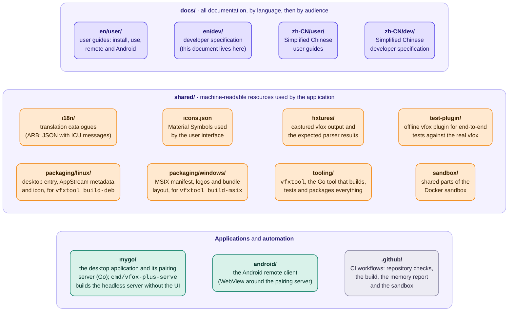
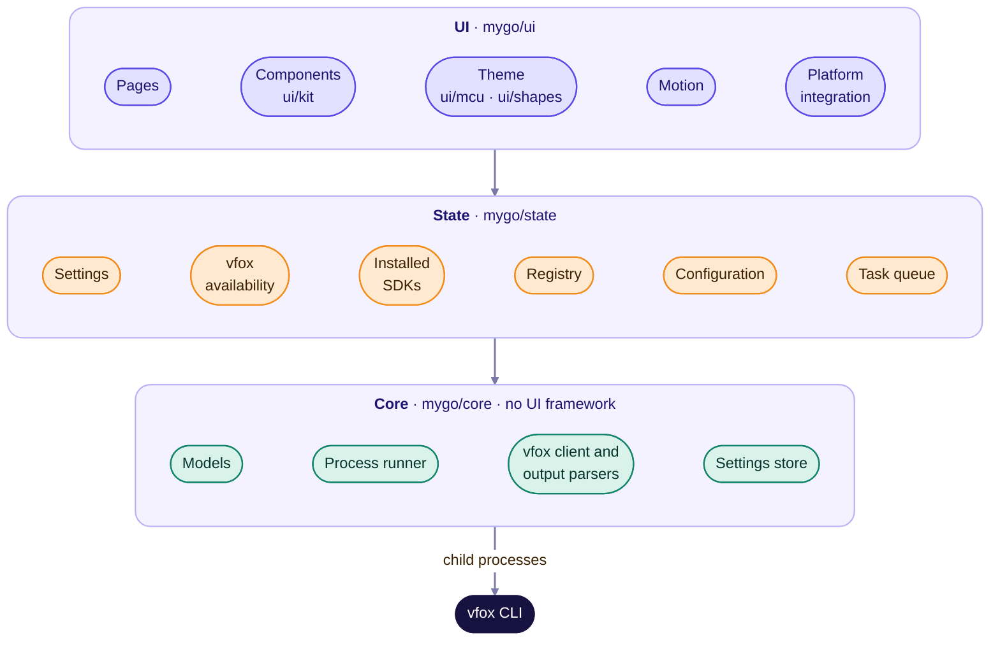

# Architecture

> [简体中文](../../zh-CN/dev/architecture.md)

vfox-plus is a graphical front end for the [vfox](https://vfox.dev) command
line tool. It is built with [mygo](https://github.com/egoist/mygo), the
desktop application framework for Go, and its native user interface: no web
view, no HTML, no JavaScript. mygo draws the window itself, from elements that
are laid out with flexbox and painted with its own renderer, and opens it
through GTK 3 without a C compiler.

## Repository layout

The application reads the shared resources from `shared/` and never copies
them, so that a translation or a fixture is changed in one place only.

## Layers

The application is organised in three layers. Dependencies only point
downwards.

**Core** is plain Go without a UI framework. It contains:

- the domain models (`InstalledSdk`, `PluginInfo`, `AvailablePlugin`,
  `AvailableVersion`, `ConfigEntry`, `UseScope`);
- a *process runner* interface with one implementation based on the platform's
  process API; tests use a scripted fake, and a future remote back end (see
  below) can provide another one;
- the *vfox client*, which builds command lines, runs read-only queries and
  parses their output, and describes state-changing operations as *commands*
  (values) instead of running them;
- the *settings store*;
- the *translation catalogues* with their ICU messages (`core/i18n`).

It is tested against `shared/fixtures`.

**State** turns core results into observable state for the UI. The most
important piece is the *task queue*: every state-changing command (install,
uninstall, use, unuse, add, remove, update) is queued and executed **one at a
time**, because vfox does not lock its data directory. Each task streams the
output of its process, extracts the download progress, keeps a bounded log and
summarises failures. When a task finishes, the installed SDKs are reloaded.

**UI** renders the state, following [the UI specification](ui-spec.md) and
[the design system](design-system.md). Desktop integration (browser, file
choosers, clipboard, accent colour) sits behind a small *platform services*
interface so that UI tests can replace it. The Material 3 Expressive
components live in `ui/kit`, built on mygo's elements and headless widgets;
the colour scheme (`ui/mcu`, a Go port of the Material colour utilities) and
the shapes (`ui/shapes`, a Go port of `androidx.graphics.shapes`) are plain Go
without a UI framework, like `core` and `state`.

In the sources the layers are `mygo/core`, `mygo/state` and `mygo/ui`
(`ui/kit`, `ui/mcu` and `ui/shapes` are part of the UI layer); `core` knows
nothing of the others, and `state` only knows `core`.

## Talking to vfox

The GUI never reads or writes vfox's files directly; everything goes through the
command line, as described in [the CLI contract](vfox-cli-contract.md). This
keeps the GUI correct across vfox releases and lets vfox keep its invariants.
The contract also lists the quirks of the current vfox output that parsers must
cope with.

Read-only queries run concurrently and are cheap (about 10 ms each); only
`vfox search` and `vfox available` may touch the network.

## Settings

Settings of the GUI itself are stored as JSON:

- on Linux, `$XDG_CONFIG_HOME/vfox-plus/settings.json` (by default
  `~/.config/vfox-plus/settings.json`);
- on Windows, `%APPDATA%/vfox-plus/settings.json`.

| Key                | Type            | Default      | Meaning                                                    |
| ------------------ | --------------- | ------------ | ---------------------------------------------------------- |
| `theme`            | string          | `"system"`   | `system`, `light` or `dark`.                               |
| `useSystemColor`   | boolean         | `true`       | Derive the colours from the desktop accent colour.         |
| `seedColor`        | integer (ARGB)  | `0xFFF28C1B` | Seed colour when the accent colour is not used.            |
| `language`         | string          | `"system"`   | `system`, `english` or `simplifiedChinese`.                |
| `vfoxExecutable`   | string          | absent       | Path of vfox; absent means "detect".                       |
| `extraEnvironment` | object          | `{}`         | Extra environment variables for vfox, e.g. mirrors.        |
| `railExpanded`     | boolean         | `false`      | Whether the navigation rail shows its labels.              |

Unknown keys must be preserved or ignored, never rejected.

The vfox configuration (proxy, registry, storage directory, …) is **not** part
of these settings: it belongs to vfox and is edited through `vfox config`.

## Locating vfox

If no executable is configured, the GUI searches `PATH`, then the usual install
locations that a desktop launcher's `PATH` often lacks:

- on Linux: `/usr/local/bin`, `/usr/bin`, `~/.local/bin`, `~/bin`,
  `~/.linuxbrew/bin`, `/home/linuxbrew/.linuxbrew/bin` and `/snap/bin`, looking
  for `vfox`;
- on Windows: `%ProgramFiles%/vfox`, `%LOCALAPPDATA%/Programs/vfox`,
  `%LOCALAPPDATA%/Microsoft/WindowsApps`, `~/scoop/shims` and `~/.vfox/bin`,
  looking for `vfox.exe` (`PATH` is split at `;`).

The user can also pick the executable. If vfox is missing or broken, the GUI explains how to install it
and keeps the settings reachable.

## Dependencies

Every runtime dependency must fall in Category A or B of the license
classification of the Apache Software Foundation
(see https://www.apache.org/legal/resolved): what the ASF allows in its
products may be used here — permissive licenses (for example Apache-2.0,
MIT, BSD, Unlicense) or weak-copyleft licenses (for example MPL-2.0,
EPL-2.0). Category X (strong copyleft such as GPL and AGPL) is excluded.
Category B dependencies ship under their own license and its conditions
(their notices stay intact and their source stays obtainable); the
application links them unmodified. mygo, the framework of the application, is under the MIT license, and
the Go modules it links are purego under the Apache License 2.0, the text
shaper `go-text/typesetting` under the Unlicense or a BSD license, and the
`golang.org/x` modules under BSD licenses, as is the Go standard library; the
QR encoder `skip2/go-qrcode` (MIT) prints the pairing link of `vfox-plus serve`
as a terminal QR code for the Android app; the
ports in `mygo/ui/mcu` and `mygo/ui/shapes` are of libraries under the Apache
License 2.0 and the MIT license, and their notices ship with the application
([`mygo/NOTICE.txt`](../../../mygo/NOTICE.txt)). The application does not link GTK 3,
GLib, Pango and Cairo, which are under the LGPL: mygo loads them from the system
when it starts, and the package depends on them as declared in
`vfxtool runtask` (`shared/tooling/internal/runtask`). The application
ships no strong-copyleft (Category X) code; weak-copyleft (Category B)
dependencies, if any, ship under their own license terms. The build tooling
in `shared/tooling` (`vfxtool`, never shipped in the application) additionally
uses `go-github` (the GitHub API for the memory report),
`nfpm` (Debian packaging as a library), `andybalholm/brotli` (WOFF2
compression for the icon font), `go-licenses` (license classification for
the license collector), `go-getter` (resumable downloads for the package
prefetch) and `golang.org/x/image` (the vector rasterizer that draws the
Windows logos, BSD-3-Clause), all Category A. The Windows `.msix` and `.msixbundle` need no
additional runtime dependency: the Go executable is self-contained and the
package carries its own logos.
Prefer the platform and the official libraries of a technology over third-party
packages, and document why each dependency is needed next to its declaration.

## Memory

Low memory use is a goal of the project. The application:

- keeps lists lazy (the version list of Node.js alone has close to 900
  entries);
- keeps the newest 500 lines of each finished task in memory (2000 while it
  streams) and forgets finished tasks past 50; a failed task keeps its full
  log on disk, pruned to the newest 20 files;
- ships only the icons it uses (the two icon font subsets total about 36 KB);
- stops animations that are not visible, and honours the platform's reduced
  motion setting;
- avoids caching data that vfox can produce again cheaply.

[The memory page](memory.md) records what the application uses.

## Remote front ends

One server owns the application state per user: the desktop application, a
background daemon or a loopback `serve` registers itself in `server.json` next
to the settings, and the others attach to it instead of starting another
model. `pair` mints its
one-time links from whichever server is live; only headless `pair` without
any server starts its own read-only snapshot server.

- **Desktop**: it embeds a loopback server on its in-process model while it
  runs with Remote access switched on in Settings (off by default) (`ServeEmbedded`), so browsers pair with the
  desktop itself. The native interface is unchanged: it still drives the model
  directly, not over HTTP.
- **`service`**: `service start` launches a detached loopback `serve` as the
  shared server when the desktop is not running; `stop`, `status`,
  `set disabled true|false` manage it. Pairing requires the shared service
  and is unavailable while it is disabled.
- **`serve`**: a loopback bind attaches to the live server (mint, print,
  wait); otherwise it starts its own model and registers it. A non-loopback
  bind always starts its own server for containers and remote instances, with
  HTTPS and the QR code as before — but remote access is off by default, so it
  refuses without an explicit `--allow-remote`.
- **`pair`**: mints from the live server, else starts a one-shot snapshot
  server when the service is not disabled.

State-changing commands stay serialized even when two models do run side by
side (for example the desktop next to a LAN `serve`): every task holds a
cross-process lock (`tasks.lock` next to the settings, `core.ProcessLock`)
while its vfox process runs, in addition to the in-process queue.

The pairing server (package `mygo/pair`) serves one-time links, expiring
sessions and mintable links, and the published
Docker image ([`mygo/Dockerfile`](../../../mygo/Dockerfile)) runs it with no
display needed. Non-loopback servers speak HTTPS: without `--tls-cert/--tls-key`
a self-signed certificate is generated next to the settings on first start,
its fingerprint is printed for comparison in the browser, and the session
cookie is Secure. A paired browser gets the full web interface at `/app`:
installed SDKs with install/use/uninstall, the plugin registry with
add/update/remove, tasks with live progress and logs over server-sent events,
and the settings. The HTTP surface the web interface uses is specified in
[the remote protocol](remote-protocol.md).

The Android client (`android/`) connects to the same server: it is a WebView
around `/app`, with a native Material 3 Expressive pairing flow (paste the
pairing link, compare the certificate fingerprint), so a phone drives the
vfox-plus instance on a PC. The web interface itself follows the
[design system](design-system.md) (seed colour, shapes, motion) with inlined
assets, because the pairing server serves a single embedded page with no
external requests.
