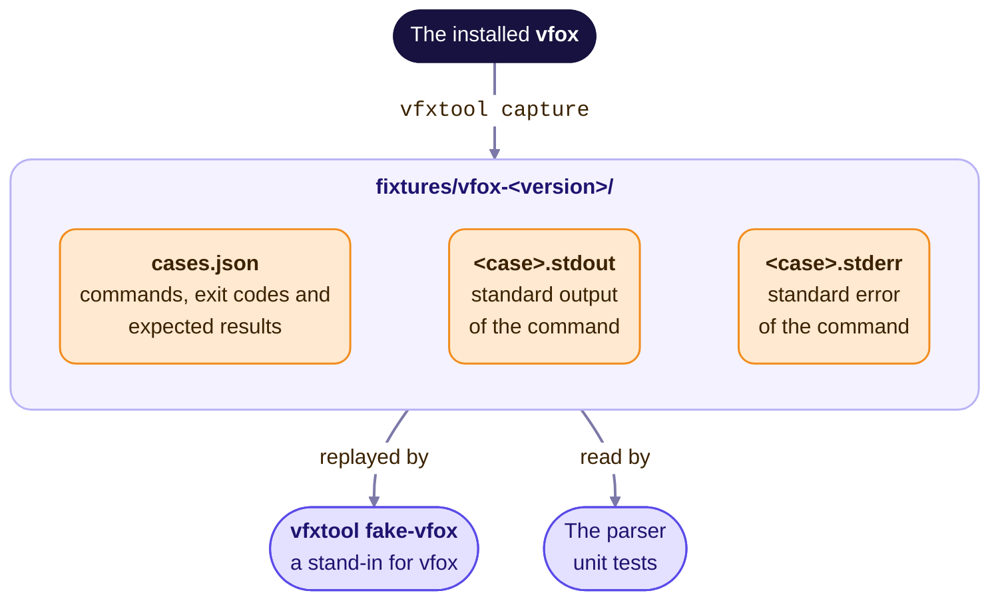

# vfox output fixtures

> [简体中文](../../zh-CN/dev/fixtures.md)

vfox prints human-oriented text, and the GUI has to parse it. This directory
holds that text, captured from real vfox runs, together with the results a
correct parser must produce. The parsers run against these files in the unit
tests, so they stay consistent with what vfox output means.

## Layout

## How the output was captured

`vfxtool capture` runs every command

- with `NO_COLOR=1`, without a terminal on stdin or stdout, which is how a GUI
  runs vfox (see [the CLI contract](vfox-cli-contract.md));
- with `HOME=/tmp/vfox-sb/home`, a throw-away sandbox, and without
  `VFOX_HOME`, so the real vfox installation is never touched and the captured
  paths are stable;
- from the working directory `/`.

Some versions are faked by creating their directories, so that the tree printed
by `vfox list` has several versions per plugin without downloading them.

Some captures contain carriage returns, escape sequences or the field separator
`0x1F`. So that every file stays plain text, `vfxtool capture` writes each control
character other than tab and line feed as `\x` followed by two lowercase
hexadecimal digits (a carriage return becomes `\x0d`), and each backslash as
`\\`. Decode a capture before passing it to a parser, by replacing both escapes
in a single pass from left to right; this gives back the exact bytes that vfox
printed.

## `cases.json`

| Field         | Meaning                                                                   |
| ------------- | ------------------------------------------------------------------------- |
| `name`        | Base name of the `.stdout` and `.stderr` files.                           |
| `command`     | Arguments passed to `vfox`.                                               |
| `environment` | Variables set in addition to the ones listed above, if any.               |
| `exitCode`    | Exit code of the command.                                                 |
| `expect`      | Expected parser results, keyed by parser. An empty object means the case is kept as a reference only. |

Expected results by parser:

| Key             | Input            | Expected value                                                             |
| --------------- | ---------------- | -------------------------------------------------------------------------- |
| `version`       | stdout           | The version number.                                                        |
| `current`       | stdout           | Plugin name to current version; `null` when no version is in effect.      |
| `list`          | stdout           | Plugin name to installed versions, in output order.                       |
| `search`        | stdout           | `count` of versions and selected `items` by index.                        |
| `available`     | stdout           | `count` of plugins and selected `items` by index.                         |
| `pluginInfo`    | stdout           | The fields of the `--format` template.                                    |
| `installPath`   | stdout           | The directory of a version, or `null` for `notfound`.                     |
| `config`        | stdout           | Every `key = value` entry, in output order.                               |
| `finalProgress` | stderr lines     | The last download progress (0–1) found, or `null` if there is none.       |
| `error`         | stdout + stderr  | The one-line error summary shown to users.                                |

Parsers must skip lines they do not understand instead of failing, and the
error summary follows the rules in the
[CLI contract](vfox-cli-contract.md#errors).

## Plugins of the version-fox organisation

`vfxtool capture` adds vfox-java and vfox-flutter last, so that the outputs of the
other cases do not list them, and captures their searches: `search-java` (OpenJDK, the
list without an argument), `search-java-tem` (one distribution), `search-java-all`
(every distribution, 2,641 versions) and `search-flutter` (457 versions on Linux x64: the
channels as notes, the Dart SDK as the bundled tool, the architecture suffixes and the
OpenHarmony builds). They were captured with vfox-java 0.6.3 and vfox-flutter 0.2.5,
and the profiles of `core/profile` are tested against them: every version name of
`search-java-all` carries a short name that the profile knows.

Their versions are faked, like those of Node.js and Maven that `list` shows: the tool
creates a directory for each version, so that nothing is downloaded. `list-profiles` and
`current-profiles` are the `list` and the `current` of a machine that has Java (21.0.12.1+1-tem
in use, 25.0.4+9-librca-fx and 25.0.2+10) and Flutter (3.47.7-x64 in use, 3.44.9-x64) next to
Node.js and Maven, and `info-java` and `info-flutter` are what the two plugins say about
themselves. The fake vfox serves them for `list` and `current` when
`VFOX_PLUS_FAKE_INVENTORY=profiles` is set, which the screenshots of those plugins need; the
searches and the plugin information it always serves.

## Updating for a new vfox release

1. Install the new vfox release and run `vfxtool capture`. It needs
   network access, takes about a minute and writes `vfox-<version>/`.
2. Copy `cases.json` from the previous version, then compare the new output
   with the old output (`diff -r`) and adjust the expected values. Keep the
   directory of the previous version when its output differs, so that the
   parsers stay tested against both (vfox 1.0.13 moved errors from standard
   output to standard error).
3. Run the parser tests, for example `cd mygo && go test ./core/...`.
4. Document any change of the output format in
   [the CLI contract](vfox-cli-contract.md).

## The fake vfox

`vfxtool fake-vfox` behaves like vfox 1.0.13 towards a GUI: it
answers the read-only commands with the captures of `vfox-1.0.13/` (or of
`VFOX_PLUS_FIXTURES`), pretends to install versions with a progress bar on
standard error, and fails like vfox when `vfox use` runs without the hook
environment. The end-to-end tools install it by copying the vfxtool binary
itself to a file named `vfox`: executed under that name, it answers vfox
commands instead of running a subcommand (see `cmd/vfxtool`). It also checks
what the CLI contract requires of the caller:
`NO_COLOR=1`, no `__VFOX_PID` of an activated shell and the working directory
`/` for commands that are not about a project. It keeps no state.
The end-to-end tests use it to try the application without touching a real vfox
installation, in end-to-end tests and in
`vfxtool measure`.
