# Remote protocol

> [简体中文](../../zh-CN/dev/remote-protocol.md)

This document specifies the HTTP surface of the servers of the web interface
(`mygo/pair`, run by the application when its settings say so): the contract the web
interface (`mygo/pair/webapp.html`) and the Android client (`android/`) program
against. The implementation is `mygo/pair/pair.go` (`Server`), `host.go` (`Host`),
`web.go` and `webapi.go`.

## Concepts

- A **pairing link** is a one-time URL `/auth/connect/<token>`. Tokens work
  once and expire after 5 minutes. Opening one pairs the browser: the server
  answers `Set-Cookie: vfox-plus-session=<session>` (`Secure`, `HttpOnly`,
  `SameSite=Lax`) and a redirect (`303`) to `/app`. The application makes the links:
  *Open in browser* and *Copy link* in its settings for the browsers of its computer,
  *Pair a phone* for the devices of the network.
- A **session** cookie authenticates every route except `/`,
  `/auth/connect/*` and `/manifest.webmanifest`. The sessions of the server for other devices
  expire after 24 hours; the sessions of the server of this computer last as long as the
  application runs. Expired sessions answer 401 and must pair again.
- State-changing routes additionally refuse the cross-origin requests of
  browsers, with the cross-origin protection of `net/http`: a request whose
  `Sec-Fetch-Site` is not `same-origin` (or `none`), or, without that header,
  whose `Origin` names another host than the one asked, answers 403. Requests with
  neither header (like curl) are allowed through with the session cookie.
- Two **servers** serve the one application state, each with its own tokens and
  sessions (see [the architecture](architecture.md#remote-front-ends)). The
  **local server** listens on `127.0.0.1` on a free port, in plain HTTP, whenever the
  setting `webInterface` is on. The **remote server** listens on `0.0.0.0` on the
  port of the setting `webPort` (8369 by default), over HTTPS only, while `webRemote` is
  on as well. Turning a setting off closes its server and every connection it holds;
  the sessions of that server end with it. Pairing does not survive a restart of the
  application.
- The pages of the web interface can read and change how other devices connect and whether
  the application stays up without its window, and can quit the application (`/api/web`,
  `/api/quit`); they cannot turn the web interface itself off.

## Pairing

| Method and path | Auth | Meaning |
| --- | --- | --- |
| `GET /` | none | Intro page: says where to get a link (the settings of the application). Never mentions tokens. |
| `GET /auth/connect/<token>` | token | Consume the token, set the session cookie, redirect to `/app`. Invalid, reused or expired tokens answer 403. |
| `GET /api/token` | session | Mint another one-time pairing link for a second browser: `{url}` rendered with the caller's host. |

The pairing code of the settings is the pairing link of the remote server, with an
address of the computer on a network in it (`Host.RemoteLink`), as a QR code
(`mygo/pair.QRMatrix`; the page of the web interface gets it as an SVG from
`POST /api/web/pairing`), so that the Android app scans instead of typing.
Other devices are off by default: the settings ask for a confirmation before they
open the computer to the network.

## Web interface

`GET /app` (session only, otherwise redirected to `/`) serves the single
embedded page: no external requests, all assets inlined, `Cache-Control:
no-store`. It follows the [design system](design-system.md) (seed colour,
shapes, motion) with inlined SVG icons.

`GET /manifest.webmanifest` (no session) serves the web app manifest of the web
interface (`application/manifest+json`, `Cache-Control: no-cache`): `name` and
`short_name` `vfox+`, `id` and `start_url` `/app`, `scope` `/`, `display`
`standalone`, the colours of the page, and one icon, the favicon as an
SVG data URI of the size `any`. Chromium browsers offer to install the web interface
as an application with it. It needs no session because it names only the
application and its start page, and because a browser may process a manifest without
the page that links it (the specification mentions installing from a sync service),
and so without the session cookie.

## Inventory

`GET /api/inventory` (session) answers the installed SDKs, the
registry and the vfox configuration in one fetch. Each section carries its
own loading and error state, like the desktop interface:

```json
{
  "vfox": {"availability": "available|missing|broken", "version": "1.0.13", "error": ""},
  "installed": {"loading": false, "value": [{"Name": "nodejs", "Versions": ["24.11.1"], "Current": "24.11.1", "HasCurrent": true}]},
  "registry": {"loading": false, "value": [{"Name": "nodejs", "Homepage": "https://…", "Official": true}]},
  "config": {"loading": false, "value": [{"Key": "proxy.enable", "Value": "false"}]},
  "complete": true
}
```

Field names follow the Go models (`core.InstalledSdk`, `core.AvailablePlugin`,
`core.ConfigEntry`); `complete` reports whether all three sections finished
within the load timeout (2 minutes).

## SDK detail

| Method and path | Meaning |
| --- | --- |
| `GET /api/sdks/<name>/info` | Plugin metadata (`core.PluginInfo`): `{Name, Version, Homepage, InstallPath, Description}`. Unknown plugins answer 404; vfox failures answer 502. |
| `GET /api/sdks/<name>/versions[?search=<value>]` | Installable versions (`core.AvailableVersion[]`): `{Version, Note, HasNote, Additions: [{Name, Version}], Installed}`. Without `search` the plugin lists the choice that the user made (what `PUT .../search` kept; the default of the plugin when none was made). `search` is the value of a choice of the plugin's [profile](#plugin-profiles) (for `java` the short name of a distribution, or `all`) and becomes the argument of `vfox search` for this request only; an unknown value, and any value for a plugin without such a choice, answer 400. For a plugin with a profile each version also has `parts` (the name taken apart: `{version, source: {value, name: {en, zh}}, flavors}`) and `facets` (`{<facet id>: [values]}`, left out when empty), so that the page needs no rules of its own. Searches may take seconds; timeouts answer 504. |
| `GET /api/sdks/<name>/profile` | The profile of the plugin, see below. Plugins without one answer 404. |
| `PUT /api/sdks/<name>/search` | Choose what the plugin lists: `{value}`, the value of a choice of its profile; the default of the plugin is a choice too, and an empty value means it. The application keeps the choice in the settings, so that it is what the plugin lists from now on, in every interface and after a restart. Answers `{value}`, the choice now. An unknown value and a body without a value answer 400, a plugin whose search takes no argument (and one without a profile) 404. |
| `PUT /api/sdks/<name>/variables` | Set one environment variable that the profile lists: `{key, value}`, an empty value takes it away. A variable the plugin does not read, a value it does not take and a body without a key answer 400 with the reason, a plugin without a profile 404. The value joins the extra environment of the settings. |

### Plugin profiles

`GET /api/sdks/<name>/profile` answers what the application knows about the plugin
(`mygo/core/profile`, see [the architecture](architecture.md#plugin-profiles)). Every
text comes in both languages, `{"en": …, "zh": …}` (`zh` is left out where it would repeat
`en`), so that the page chooses by its own language setting:

```json
{
  "plugin": "java", "naming": "java",
  "search": {"label": {"en": "Distribution", "zh": "发行版"}, "default": "open", "current": "tem",
             "choices": [{"value": "tem", "name": {"en": "Temurin"}, "maker": {"en": "Eclipse Adoptium"}, "aliases": ["temurin"], "popular": true}]},
  "shorthands": [{"name": "21-tem", "meaning": {"en": "The newest Temurin 21", "zh": "最新的 Temurin 21"}}],
  "variables": [{"key": "VFOX_JAVA_GITHUB_MIRROR", "label": {"en": "GitHub mirror"}, "help": {"en": "…"},
                 "kind": "url", "presets": [{"value": "https://gh-proxy.org/", "name": {"en": "gh-proxy"}}], "example": "https://gh-proxy.org/", "value": ""}],
  "legacyFiles": [".sdkmanrc"], "legacyStrategy": false,
  "facets": [{"id": "support", "label": {"en": "Support"}, "values": ["LTS"]}],
  "guide": {"en": "…"}, "tips": [{"en": "…"}], "docs": [{"title": {"en": "Versions and names"}, "url": {"en": "https://…"}}],
  "installed": {"21.0.12.1+1-tem": {"version": "21.0.12.1+1", "source": {"value": "tem", "name": {"en": "Temurin"}}, "flavors": []}}
}
```

`variables[].value` is what vfox runs with now, and `installed` takes the names of the
installed versions apart. `search.current` is the value of the choice that the plugin lists.
`naming` is `java`, `flutter` or `plain`.

A plugin that was added under an alias (`vfox add --alias coffee java`) is named by the
alias in every path of `/api/sdks/<name>/…`, and has the profile of the plugin it was made
from: the server asks `vfox info` which plugin it is. The choice of its search is kept under
the alias.

## Tasks

Task life cycle:

```mermaid
---
config:
  theme: base
  themeVariables:
    fontFamily: "system-ui, -apple-system, 'Segoe UI', 'Noto Sans', 'Noto Sans CJK SC', 'PingFang SC', 'Microsoft YaHei', sans-serif"
    lineColor: "#7C79A8"
    primaryColor: "#FFE9D0"
    primaryBorderColor: "#F28C1B"
    primaryTextColor: "#3B2200"
    clusterBkg: "#F4F2FF"
    clusterBorder: "#B9B3F5"
    titleColor: "#1E1470"
    edgeLabelBackground: "#FFFFFF"
  flowchart:
    curve: basis
    wrappingWidth: 320
    subGraphTitleMargin:
      top: 10
      bottom: 8
---
stateDiagram-v2
    accTitle: Task life cycle
    accDescr: A task is queued, runs, and ends as succeeded, failed or cancelled; a queued task can also be cancelled.
    direction LR
    [*] --> queued: POST /api/tasks
    queued --> running: its turn
    queued --> cancelled: cancel
    running --> succeeded: exit code 0
    running --> failed: cannot start, or<br/>exit code ≠ 0
    running --> cancelled: cancel, the<br/>process is killed
    succeeded --> [*]
    failed --> [*]
    cancelled --> [*]

    classDef wait fill:#E4E0FF,stroke:#5A4BE8,color:#1E1470,stroke-width:1.5px
    classDef busy fill:#FFE9D0,stroke:#F28C1B,color:#3B2200,stroke-width:1.5px
    classDef good fill:#D9F2EA,stroke:#13836B,color:#06332A,stroke-width:1.5px
    classDef bad fill:#FFDAD6,stroke:#BA1A1A,color:#410002,stroke-width:1.5px
    classDef stop fill:#ECEBF3,stroke:#8E8BA8,color:#2B2840,stroke-width:1.5px
    class queued wait
    class running busy
    class succeeded good
    class failed bad
    class cancelled stop
```



One state-changing command runs at a time; the rest queue. The queue is
per process, and every task additionally holds a cross-process file lock
(`tasks.lock` next to the settings) while its vfox process runs, so the
applications of two users on one vfox data directory still serialize mutations.

| Method and path | Meaning |
| --- | --- |
| `GET /api/tasks` | List tasks, newest first, with the newest 50 log lines each. |
| `POST /api/tasks` | Start a task: `{operation, sdk?, version?, scope?, source?, alias?}`. Answers 201 with the task. |
| `GET /api/tasks/<id>` | One task with the newest 500 log lines. |
| `GET /api/tasks/<id>/log` | The retained full log of a failed task as plain text (404 when none was kept). |
| `POST /api/tasks/<id>/cancel` | Cancel a queued or running task. |
| `POST /api/tasks/<id>/retry` | Run a finished task again. |
| `DELETE /api/tasks/finished` | Forget finished tasks: `{cleared: true}`. |

A task carries `hasFullLog` when its complete output was kept on disk. The
queue spills every running task to per-task files under the OS user cache
(`vfox-plus/tasks`), capped per file and pruned to the newest 20; only
failed tasks keep theirs, successful and cancelled ones delete theirs, and a
forgotten finished task deletes its file with it. A task looks like this:

```json
{"id": 3, "operation": "install", "sdk": "nodejs", "version": "24.11.1",
 "commandLine": "vfox install --yes nodejs@24.11.1", "status": "running",
 "progress": 0.42, "createdAt": "…", "startedAt": "…",
 "log": ["…"], "droppedLines": 0}
```

Operations: `install` (sdk + version), `uninstall` (sdk + version), `use`
(sdk + version, only the `global` scope — browsers cannot name a directory
on the machine that runs vfox), `unuse` (sdk), `add` (remote URL `source` +
optional `alias`; local paths are rejected), `remove` (sdk), `update` (sdk,
or empty for `--all`). Unknown operations and missing fields answer 400.

## Plugins

`POST /api/plugins` (session, same-origin) adds a plugin from a JSON body
`{source, alias?}` (remote URLs only) or from a `multipart/form-data` upload
(`file` plus optional `alias`, at most 33 MiB). Uploads are written to a
private directory with mode `0600` and deleted by the task finalizer. Answers
201 with the task.

## Settings and vfox configuration

| Method and path | Meaning |
| --- | --- |
| `GET /api/settings` | The editable GUI settings: `{vfoxExecutable, extraEnvironment, language}`. |
| `PUT /api/settings` | Update them (`language` is `system`, `english` or `simplifiedChinese`). Unknown languages answer 400. |
| `GET /api/web` | How other devices connect, and whether the application stays up without its window: `{remote, port, lightweight, listening, addresses[], fingerprint, selfSigned, error}`. `remote`, `port` and `lightweight` are the settings `webRemote`, `webPort` and `lightweight`; the rest says what the remote server made of them: whether it `listening`, the `addresses` of the computer on its networks (IPv4 first), the SHA-256 `fingerprint` of its certificate and whether the application made it (`selfSigned`), and `error` when other devices are allowed and cannot connect (the port is taken, the certificate does not load). |
| `PUT /api/web` | Change any of `{remote, port, lightweight}` (same-origin). A `port` outside 1024 to 65535 answers 400. The answer is the new `GET /api/web`, which may still show the servers as they were: they follow the settings at once, and the page learns of it by the `web` event. |
| `POST /api/web/pairing` | Make a pairing link for a device on the network (same-origin): the body may name the `host`, one of the `addresses`, and answers `{url, svg}`, the link and its QR code as an SVG. 409 when other devices cannot connect or the address is none of the computer's. |
| `POST /api/quit` | Quit the application (same-origin): answers 202 `{quitting: true}` and quits shortly after. Cancels the tasks that run. |
| `PUT /api/config` | Set one vfox key: `{key, value}`. vfox failures answer 502 with its message. |
| `DELETE /api/config?key=<key>` | Reset one vfox key to its default. |

## Events

`GET /api/events` (session) is a server-sent-events stream. Messages are
`event: <kind>` with an empty JSON payload; the client refetches what
changed. Kinds: `hello` (after connecting), `task`, `inventory`, `vfox`, `web` (the connections of other devices changed). A
`: ping` heartbeat comment every 25 seconds keeps proxies from closing idle
connections.

## TLS

The remote server always speaks HTTPS, and `NewServer` refuses to listen beyond loopback
without a certificate. Without `webCertificate` and `webKey` in the settings, the
application generates a self-signed pair next to the settings the first time
that other devices are allowed (`mygo/pair/tlscert.go`) and the settings show its SHA-256
fingerprint. Clients — the browser and the Android app — must show that fingerprint for
comparison before trusting the certificate. Bringing your own certificate avoids the warning.
The session cookie is always `Secure`: loopback origins are trustworthy, so
browsers send it back over plain HTTP there.

## Android client

`android/` is a thin native wrapper around this protocol:

- The **pairing flow** is native (Material 3 Expressive): paste the pairing
  link (or scan it), show the TLS fingerprint for comparison, persist the
  session cookie.
- The **main content** is a WebView of `/app` with file upload enabled (for
  plugin `.zip`/`.lua` files) and pull handling left to the page.
- The page and the app talk through `window.vfoxAndroid`, an object that the app
  adds to the WebView (`WebBridge`) and that no other client has, so that a page
  that finds it knows that it runs in the app:
  - `insets()` returns the safe area as `"top,right,bottom,left,keyboard"` in CSS
    pixels: what the system bars and a display cutout cover, and the height of the
    keyboard while it is open. The page puts the first four into the CSS
    variables `--sai-top`, `--sai-right`, `--sai-bottom` and `--sai-left` (in a
    browser they are `env(safe-area-inset-*)`, and a WebView does not give
    that in every version), and marks the root element `kb` while the keyboard
    is open. The app calls `window.vfoxInsets()` again whenever the insets
    change.
  - `server()` returns the address of the paired server, scheme and authority.
  - `pairNew()` and `disconnect()` leave the session for the pairing screen;
    the second forgets the server and the session cookie first. The settings of
    the page offer both on the **This phone** card, which only the app shows.
- It programs against this document, not against the Go code: inventory for
  lists, `/api/tasks` + `/api/events` for progress, `POST` routes for
  actions.

## The gateway

`mygo/gateway` (the Docker image, see [the gateway](architecture.md#the-gateway)) serves the interface
of one instance to the browsers that are paired with it, over HTTPS on port 8080. It speaks this
protocol twice. To its browsers it is a server: the same one-time links (`/auth/connect/<token>`, five
minutes) and sessions (24 hours), with the cookie `vfox-plus-gateway`. To the remote server of an
instance it is a client, as the Android app is: a pairing link that a person pasted, the session cookie
`vfox-plus-session`, and the certificate trusted by the roots or by a fingerprint.

| Route | Answered by | Notes |
| --- | --- | --- |
| `GET /` | the gateway | The page that says how to pair, for a browser that is not paired; for one that is, the instance it is paired with and the forms below. |
| `GET /auth/connect/<token>` | the gateway | Pairs the browser: `303` to `/app` when the gateway is paired with an instance, to `/` when it is not. `403` for a link that is not valid, was used or expired. |
| `GET /api/token` | the gateway | A session of the gateway: `{"url": "https://<host of the request>/auth/connect/<token>"}`, a link for a second browser. |
| `POST /gateway/connect` | the gateway | A paired browser, from the page, with the form field `link`: a pairing link of an instance. `303` to `/app` when the gateway is paired with it; `200` with the fingerprint to compare when nobody vouches for its certificate and it is not the one that was trusted; `400` when it is not a pairing link (an address that is not a host name or an IP address, with a port from 1 to 65535 or none, is not one); `403` when the instance refused it; `502` when it cannot be reached. |
| `POST /gateway/trust` | the gateway | `link` and `fingerprint`, from the page that shows it: pairs with the certificate that has that fingerprint (`409` when the certificate at the address is not the one that was shown). |
| `POST /gateway/invite` | the gateway | A page with a link for another browser. |
| `POST /gateway/forget` | the gateway | Forgets the instance and the session at it; `303` to `/`. |
| `/app`, `/api/*`, `/manifest.webmanifest` | the instance | Forwarded with the session of the gateway (the manifest also to a browser that is not paired, as the instance serves it). |

The forms of the gateway need a paired browser (`401`), the origin of the gateway (`403`) and at most 8 KiB
(`400`). A route of the instance, for a browser that is not paired with the gateway, is `401` (and `/app`
is a redirect to `/`), and so is every route when the gateway is paired with no instance or its session
ended: the answer says so in the form that the interface reads errors in, `{"error": "…"}`. When the
instance cannot be reached the API answers `502` in the same form and `/app` answers `502` with a page.
Everything of the browser that identifies it (its cookies, `Origin`, `Referer`, the `Forwarded` headers)
stays with the gateway, and the `Set-Cookie` of the instance does not reach the browser.
