# Remote protocol

> [简体中文](../../zh-CN/dev/remote-protocol.md)

This document specifies the HTTP surface of the pairing server (`mygo/pair`,
`vfox-plus pair` / `vfox-plus serve`): the contract the web interface
(`mygo/pair/webapp.html`) and the Android client (`android/`) program
against. The implementation is `mygo/pair/pair.go` (`Server`), `web.go` and
`webapi.go`.

## Concepts

- A **pairing link** is a one-time URL `/auth/connect/<token>`. Tokens work
  once and expire after `--token-ttl` (default 5 minutes). Opening one pairs
  the browser: the server answers `Set-Cookie: vfox-plus-session=<session>`
  (`Secure`, `HttpOnly`, `SameSite=Lax`).
- A **session** cookie authenticates every route except `/`,
  `/auth/connect/*` and `/manifest.webmanifest`. `serve` sessions expire after `--session-ttl` (default 24
  hours); expired sessions answer 401 and must pair again.
- State-changing routes additionally require a same-origin `Origin` or
  `Referer` when the caller sends one; requests without either (like curl)
  are allowed through with the session cookie.
- One **shared server** owns the application state per user: the desktop embeds
  one while it runs, a `service start` daemon or a loopback `serve` registers
  itself as one, and `pair` mints from whichever is live. Discovery is `server.json` next to the
  settings (`{"pid", "port", "adminToken", "owner", "startedAt"}`, mode 0600);
  a stale file is removed on discovery. `pair` without any live server starts
  its own read-only snapshot server instead, unless the service is disabled
  (`service.json`, `{"disabled": true}`).
- The **admin bearer** mints links over loopback without a session: `pair`
  and loopback `serve` read the token from the discovery file and call
  `GET /api/token` with `Authorization: Bearer <token>`. It is refused on
  non-loopback connections even when correct, and it never becomes a cookie.
- `pair` mode serves only the pairing flow and the read-only snapshot. The
  routes below need `serve` mode, which owns an `AppModel`.

## Pairing

| Method and path | Auth | Meaning |
| --- | --- | --- |
| `GET /` | none | Intro page. Never mentions tokens. |
| `GET /auth/connect/<token>` | token | Consume the token, set the session cookie, render the result page. Invalid, reused or expired tokens answer 403. |
| `GET /api/status` | session | Read-only snapshot (`pair` mode): `{hasVfox, vfoxVersion?, vfoxError?, sdks[]}` with `sdks[] = {name, current, hasCurrent, versions[]}`. |
| `GET /api/token` | session, or admin bearer over loopback | Mint another one-time pairing link for a second browser (or for the local CLI): `{url}` rendered with the caller's host. |

On a terminal, `vfox-plus serve` on a non-loopback bind also prints the
pairing link as a QR code (`mygo/pair.TerminalQRCode`) with a reachable LAN
address (`ReachablePairingURL`), so the Android app scans instead of typing.
Loopback binds stay text-only: a phone could not reach them anyway. Remote
access is off by default: `serve` refuses non-loopback binds without an
explicit `--allow-remote` (the published Docker image opts in through its
`CMD`).

## Web interface

`GET /app` (session only, otherwise redirected to `/`) serves the single
embedded page: no external requests, all assets inlined, `Cache-Control:
no-store`. It follows the [design system](design-system.md) (seed colour,
shapes, motion) with inlined SVG icons.

`GET /manifest.webmanifest` (no session) serves the web app manifest of the web
interface (`application/manifest+json`, `Cache-Control: no-cache`): `name` and
`short_name` `vfox+`, `id` and `start_url` `/app`, `scope` `/`, `display`
`standalone`, the colours of the page, and one icon, the favicon as an
SVG data URI of the size `any`. Chromium browsers offer to install the web interface
as an application with it. It needs no session because it names only the
application and its start page, and because a browser may process a manifest without
the page that links it (the specification mentions installing from a sync service),
and so without the session cookie.

## Inventory

`GET /api/inventory` (session, `serve` only) answers the installed SDKs, the
registry and the vfox configuration in one fetch. Each section carries its
own loading and error state, like the desktop interface:

```json
{
  "vfox": {"availability": "available|missing|broken", "version": "1.0.13", "error": ""},
  "installed": {"loading": false, "value": [{"Name": "nodejs", "Versions": ["24.11.1"], "Current": "24.11.1", "HasCurrent": true}]},
  "registry": {"loading": false, "value": [{"Name": "nodejs", "Homepage": "https://…", "Official": true}]},
  "config": {"loading": false, "value": [{"Key": "proxy.enable", "Value": "false"}]},
  "complete": true
}
```

Field names follow the Go models (`core.InstalledSdk`, `core.AvailablePlugin`,
`core.ConfigEntry`); `complete` reports whether all three sections finished
within the load timeout (2 minutes).

## SDK detail

| Method and path | Meaning |
| --- | --- |
| `GET /api/sdks/<name>/info` | Plugin metadata (`core.PluginInfo`): `{Name, Version, Homepage, InstallPath, Description}`. Unknown plugins answer 404; vfox failures answer 502. |
| `GET /api/sdks/<name>/versions[?search=<value>]` | Installable versions (`core.AvailableVersion[]`): `{Version, Note, HasNote, Additions: [{Name, Version}], Installed}`. `search` is the value of a choice of the plugin's [profile](#plugin-profiles) (for `java` the short name of a distribution, or `all`) and becomes the argument of `vfox search`; an unknown value, and any value for a plugin without such a choice, answer 400. For a plugin with a profile each version also has `parts` (the name taken apart: `{version, source: {value, name: {en, zh}}, flavors}`) and `facets` (`{<facet id>: [values]}`, left out when empty), so that the page needs no rules of its own. Searches may take seconds; timeouts answer 504. |
| `GET /api/sdks/<name>/profile` | The profile of the plugin, see below. Plugins without one answer 404. |
| `PUT /api/sdks/<name>/variables` | Set one environment variable that the profile lists: `{key, value}`, an empty value takes it away. A variable the plugin does not read, a value it does not take and a body without a key answer 400 with the reason, a plugin without a profile 404. The value joins the extra environment of the settings. |

### Plugin profiles

`GET /api/sdks/<name>/profile` answers what the application knows about the plugin
(`mygo/core/profile`, see [the architecture](architecture.md#plugin-profiles)). Every
text comes in both languages, `{"en": …, "zh": …}` (`zh` is left out where it would repeat
`en`), so that the page chooses by its own language setting:

```json
{
  "plugin": "java", "naming": "java",
  "search": {"label": {"en": "Distribution", "zh": "发行版"}, "default": "open",
             "choices": [{"value": "tem", "name": {"en": "Temurin"}, "maker": {"en": "Eclipse Adoptium"}, "aliases": ["temurin"], "popular": true}]},
  "shorthands": [{"name": "21-tem", "meaning": {"en": "The newest Temurin 21", "zh": "最新的 Temurin 21"}}],
  "variables": [{"key": "VFOX_JAVA_GITHUB_MIRROR", "label": {"en": "GitHub mirror"}, "help": {"en": "…"},
                 "kind": "url", "presets": [{"value": "https://gh-proxy.org/", "name": {"en": "gh-proxy"}}], "example": "https://gh-proxy.org/", "value": ""}],
  "legacyFiles": [".sdkmanrc"], "legacyStrategy": false,
  "facets": [{"id": "support", "label": {"en": "Support"}, "values": ["LTS"]}],
  "guide": {"en": "…"}, "tips": [{"en": "…"}], "docs": [{"title": {"en": "Versions and names"}, "url": {"en": "https://…"}}],
  "installed": {"21.0.12.1+1-tem": {"version": "21.0.12.1+1", "source": {"value": "tem", "name": {"en": "Temurin"}}, "flavors": []}}
}
```

`variables[].value` is what vfox runs with now, and `installed` takes the names of the
installed versions apart. `naming` is `java`, `flutter` or `plain`.

## Tasks

Task life cycle:

```mermaid
---
config:
  theme: base
  themeVariables:
    fontFamily: "system-ui, -apple-system, 'Segoe UI', 'Noto Sans', 'Noto Sans CJK SC', 'PingFang SC', 'Microsoft YaHei', sans-serif"
    lineColor: "#7C79A8"
    primaryColor: "#FFE9D0"
    primaryBorderColor: "#F28C1B"
    primaryTextColor: "#3B2200"
    clusterBkg: "#F4F2FF"
    clusterBorder: "#B9B3F5"
    titleColor: "#1E1470"
    edgeLabelBackground: "#FFFFFF"
  flowchart:
    curve: basis
    wrappingWidth: 320
    subGraphTitleMargin:
      top: 10
      bottom: 8
---
stateDiagram-v2
    accTitle: Task life cycle
    accDescr: A task is queued, runs, and ends as succeeded, failed or cancelled; a queued task can also be cancelled.
    direction LR
    [*] --> queued: POST /api/tasks
    queued --> running: its turn
    queued --> cancelled: cancel
    running --> succeeded: exit code 0
    running --> failed: cannot start, or<br/>exit code ≠ 0
    running --> cancelled: cancel, the<br/>process is killed
    succeeded --> [*]
    failed --> [*]
    cancelled --> [*]

    classDef wait fill:#E4E0FF,stroke:#5A4BE8,color:#1E1470,stroke-width:1.5px
    classDef busy fill:#FFE9D0,stroke:#F28C1B,color:#3B2200,stroke-width:1.5px
    classDef good fill:#D9F2EA,stroke:#13836B,color:#06332A,stroke-width:1.5px
    classDef bad fill:#FFDAD6,stroke:#BA1A1A,color:#410002,stroke-width:1.5px
    classDef stop fill:#ECEBF3,stroke:#8E8BA8,color:#2B2840,stroke-width:1.5px
    class queued wait
    class running busy
    class succeeded good
    class failed bad
    class cancelled stop
```



One state-changing command runs at a time; the rest queue. The queue is
per process, and every task additionally holds a cross-process file lock
(`tasks.lock` next to the settings) while its vfox process runs, so the
desktop next to a LAN `serve` still serializes mutations.

| Method and path | Meaning |
| --- | --- |
| `GET /api/tasks` | List tasks, newest first, with the newest 50 log lines each. |
| `POST /api/tasks` | Start a task: `{operation, sdk?, version?, scope?, source?, alias?}`. Answers 201 with the task. |
| `GET /api/tasks/<id>` | One task with the newest 500 log lines. |
| `GET /api/tasks/<id>/log` | The retained full log of a failed task as plain text (404 when none was kept). |
| `POST /api/tasks/<id>/cancel` | Cancel a queued or running task. |
| `POST /api/tasks/<id>/retry` | Run a finished task again. |
| `DELETE /api/tasks/finished` | Forget finished tasks: `{cleared: true}`. |

A task carries `hasFullLog` when its complete output was kept on disk. The
queue spills every running task to per-task files under the OS user cache
(`vfox-plus/tasks`), capped per file and pruned to the newest 20; only
failed tasks keep theirs, successful and cancelled ones delete theirs, and a
forgotten finished task deletes its file with it. A task looks like this:

```json
{"id": 3, "operation": "install", "sdk": "nodejs", "version": "24.11.1",
 "commandLine": "vfox install --yes nodejs@24.11.1", "status": "running",
 "progress": 0.42, "createdAt": "…", "startedAt": "…",
 "log": ["…"], "droppedLines": 0}
```

Operations: `install` (sdk + version), `uninstall` (sdk + version), `use`
(sdk + version, only the `global` scope — browsers cannot name a directory
on the machine that runs vfox), `unuse` (sdk), `add` (remote URL `source` +
optional `alias`; local paths are rejected), `remove` (sdk), `update` (sdk,
or empty for `--all`). Unknown operations and missing fields answer 400.

## Plugins

`POST /api/plugins` (session, same-origin) adds a plugin from a JSON body
`{source, alias?}` (remote URLs only) or from a `multipart/form-data` upload
(`file` plus optional `alias`, at most 33 MiB). Uploads are written to a
private directory with mode `0600` and deleted by the task finalizer. Answers
201 with the task.

## Settings and vfox configuration

| Method and path | Meaning |
| --- | --- |
| `GET /api/settings` | The editable GUI settings: `{vfoxExecutable, extraEnvironment, language}`. |
| `PUT /api/settings` | Update them (`language` is `system`, `english` or `simplifiedChinese`). Unknown languages answer 400. |
| `PUT /api/config` | Set one vfox key: `{key, value}`. vfox failures answer 502 with its message. |
| `DELETE /api/config?key=<key>` | Reset one vfox key to its default. |

## Events

`GET /api/events` (session) is a server-sent-events stream. Messages are
`event: <kind>` with an empty JSON payload; the client refetches what
changed. Kinds: `hello` (after connecting), `task`, `inventory`, `vfox`. A
`: ping` heartbeat comment every 25 seconds keeps proxies from closing idle
connections.

## TLS

Non-loopback binds always speak HTTPS. Without `--tls-cert/--tls-key`, the
server generates a self-signed pair next to the settings on first start
(`mygo/pair/tlscert.go`) and prints its SHA-256 fingerprint. Clients — the
browser and the Android app — must show that fingerprint for comparison before
trusting the certificate. Bringing your own certificate avoids the warning.
The session cookie is always `Secure`: loopback origins are trustworthy, so
browsers send it back over plain HTTP there.

## Android client

`android/` is a thin native wrapper around this protocol:

- The **pairing flow** is native (Material 3 Expressive): paste the pairing
  link (or scan it), show the TLS fingerprint for comparison, persist the
  session cookie.
- The **main content** is a WebView of `/app` with file upload enabled (for
  plugin `.zip`/`.lua` files) and pull handling left to the page.
- It programs against this document, not against the Go code: inventory for
  lists, `/api/tasks` + `/api/events` for progress, `POST` routes for
  actions.
