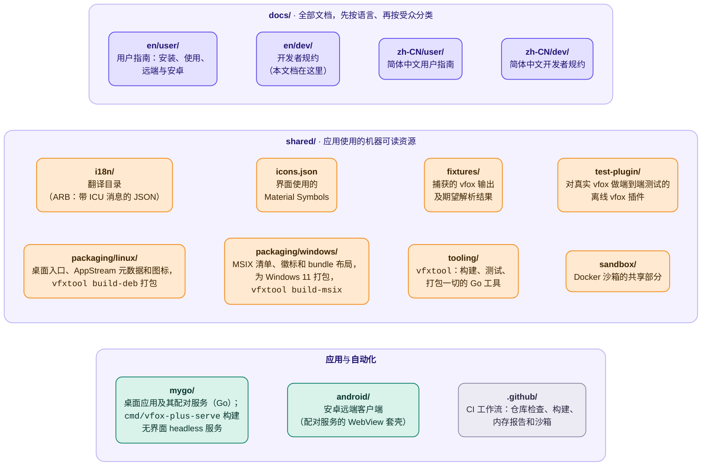
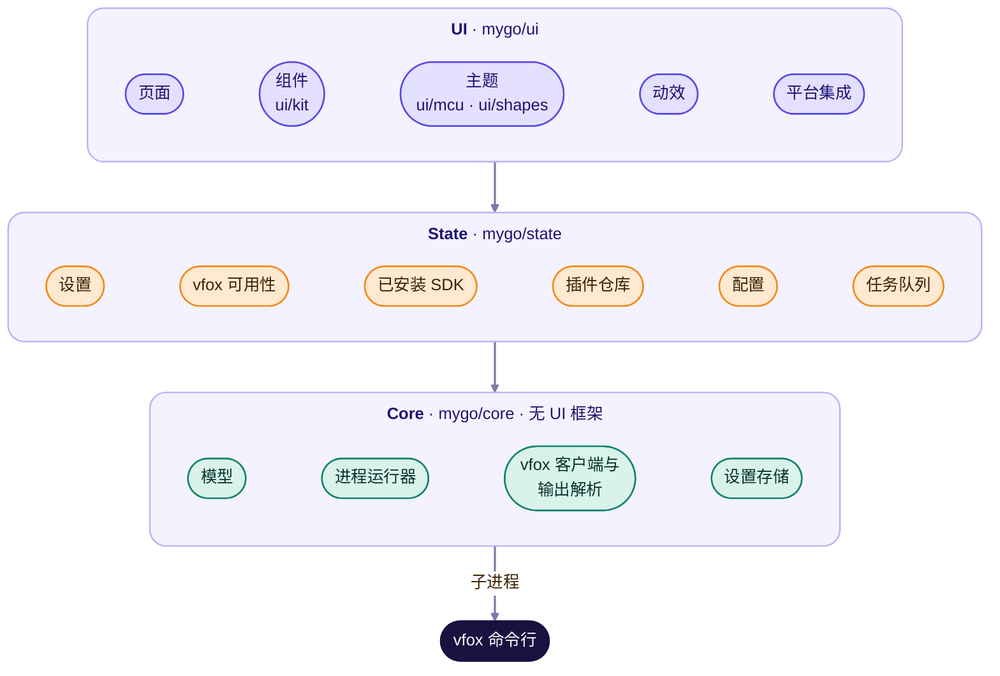
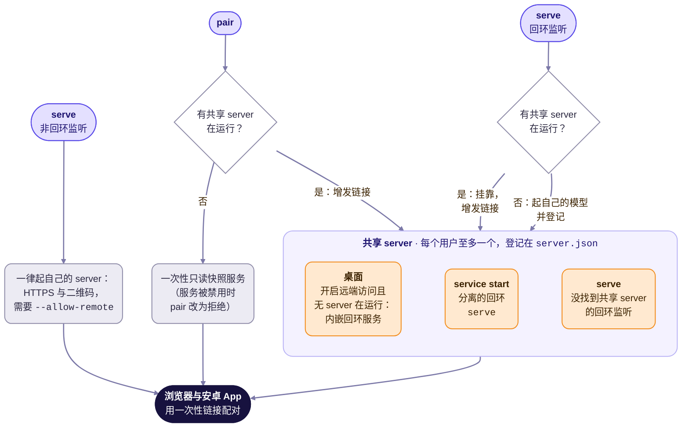

# 架构

> [English](../../en/dev/architecture.md)

vfox-plus 是 [vfox](https://vfox.dev) 命令行工具的图形化前端。它使用
[mygo](https://github.com/egoist/mygo)（Go 桌面应用框架）及其原生用户界面构建：
无 Web 视图、无 HTML、无 JavaScript。mygo 从 flexbox 布局的元素出发，用自研渲染器
绘制窗口，经 GTK 3 打开，无需 C 编译器。

## 仓库布局

应用从 `shared/` 读取共享资源，从不复制，保证翻译或夹具只改一处。

## 分层

应用分三层，依赖只向下。

**Core** 是不依赖 UI 框架的纯 Go，包含：

- 领域模型（`InstalledSdk`、`PluginInfo`、`AvailablePlugin`、
  `AvailableVersion`、`ConfigEntry`、`UseScope`）；
- *进程运行器*接口，按平台进程 API 实现；测试用脚本化替身，未来远端后端（见
  下）可提供另一实现；
- *vfox 客户端*：组装命令行、运行只读查询并解析输出，把改变状态的操作描述为
  *命令*（值）而不直接执行；
- *设置存储*；
- 带 ICU 消息的*翻译目录*（`core/i18n`）；
- *插件配置档案*（`core/profile`），见下。

它用 `shared/fixtures` 测试。

**State** 把 core 结果变成 UI 可观察状态。最重要的是*任务队列*：每个改变状态的
命令（安装、卸载、使用、取消使用、添加、移除、更新）都排队**一次执行一个**，
因为 vfox 不锁数据目录。每个任务流式输出进程内容、提取下载进度、保留有界日志
并总结失败。任务结束重载已安装 SDK。

**UI** 按[界面规约](ui-spec.md)和[设计系统](design-system.md)渲染状态。桌面集成
（浏览器、文件选择器、剪贴板、强调色）藏在小*平台服务*接口后，UI 测试可替换。
Material 3 Expressive 组件在 `ui/kit`，基于 mygo 元素与无样式部件；
配色（`ui/mcu`，Material 颜色工具的 Go 移植）与形状（`ui/shapes`，
`androidx.graphics.shapes` 的 Go 移植）和 `core`、`state` 一样是无 UI 框架的纯 Go。

源码中三层是 `mygo/core`、`mygo/state`、`mygo/ui`
（`ui/kit`、`ui/mcu`、`ui/shapes` 属 UI 层）；`core` 不知道其它层，`state` 只知道
`core`。

## 插件配置档案

vfox 对每个插件都用同样的方式列出、安装、选择与移除版本，但 version-fox 组织的插件提供的更多，
这些在 vfox 的输出里一点也看不出来：`vfox search java tem` 列出 Java 的一个发行版，而 `vfox search java`
只列出 OpenJDK；`nodejs@24` 安装最新的 Node.js 24，`flutter@stable` 安装某个通道的版本；每个插件还会读取
把下载指向镜像的环境变量与 `.nvmrc` 之类的版本文件。不了解这些，界面只能提供所有插件共有的功能，
第一版的 Web 界面就是这样只显示了 Java 的 OpenJDK 列表（[#43](https://github.com/version-fox/vfox-plus/issues/43)）。

*配置档案*（`core/profile`）把这些写成三个界面共用的纯数据，覆盖 `java`、`nodejs` 与 `flutter`：

| 部分 | 内容 |
| --- | --- |
| 搜索 | `vfox search` 里插件名后面的参数：`java` 有 Foojay 的 31 个发行版与 `all`（Linux loong64 上改为 Loongnix JDK），以及 vfox 不带参数时用的那个 |
| 简写 | `vfox install <插件>@<名称>` 除列出的版本外接受的名称 |
| 变量 | 插件读取的环境变量，附已检查过的镜像，以及每个变量接受什么（`http://` 或 `https://` 地址，或少数几个值） |
| 版本文件 | vfox 通过该插件读取的文件，以及 vfox 设置 `legacyVersionFile.strategy` 对它们是否有影响 |
| 筛选维度 | 适合已列出版本的备注与名称的筛选：`LTS`、`JavaFX`、Flutter 的通道与架构 |
| 命名 | 版本名称的构成，所以 `21.0.12.1+1-tem` 显示 Temurin，`3.47.7-x64` 显示 x64 |
| 说明、须知、文档 | 几句关于名称的说明、容易让人意外的地方，以及该插件文档的链接 |

档案里的文字用两种语言写在数据旁边，而不放进翻译目录，因为 Web 界面通过 HTTP 获取它们，无头服务器也不带
翻译目录。没有档案的插件行为与从前相同。注册表是 `state.AppModel.Profiles`；端到端测试为它们的离线测试
插件注册了一份档案。

`SdkDetailController` 保存所选的搜索（`SetSearch` 会忘掉之前的列表与筛选维度；有人要列表时才加载）与所选
筛选维度；`AppModel.SetPluginVariable` 按变量检查一个值，并把它存入设置里的额外环境变量，每个 vfox 进程
都带着它运行。

## 与 vfox 对话

GUI 从不直接读写 vfox 文件，一切走命令行，见
[CLI 契约](vfox-cli-contract.md)。这让 GUI 跨 vfox 版本保持正确，也让 vfox 保持
自身不变式。契约还列出解析器必须容忍的现行 vfox 输出 quirks。

只读查询并发跑且便宜（每次约 10 ms）；只有 `vfox search` 和 `vfox available`
可能联网。

## 设置

GUI 自身设置存为 JSON：

- Linux：`$XDG_CONFIG_HOME/vfox-plus/settings.json`（默认
  `~/.config/vfox-plus/settings.json`）；
- Windows：`%APPDATA%/vfox-plus/settings.json`。

| 键 | 类型 | 默认 | 含义 |
| --- | --- | --- | --- |
| `theme` | string | `"system"` | `system`、`light` 或 `dark`。 |
| `useSystemColor` | boolean | `true` | 从桌面强调色派生颜色。 |
| `seedColor` | integer (ARGB) | `0xFFF28C1B` | 不用强调色时的种子颜色。 |
| `language` | string | `"system"` | `system`、`english` 或 `simplifiedChinese`。 |
| `vfoxExecutable` | string | 无 | vfox 路径；无表示自动探测。 |
| `extraEnvironment` | object | `{}` | 给 vfox 的额外环境变量，如镜像。 |
| `railExpanded` | boolean | `false` | 导航栏是否显示标签。 |

未知键必须保留或忽略，不得拒绝。

vfox 配置（代理、仓库、存储目录等）**不是**这些设置的一部分：它属于 vfox，经
`vfox config` 编辑。

## 查找 vfox

未配置可执行文件时，GUI 先搜 `PATH`，再搜桌面启动器 `PATH` 常缺的常见安装位置：

- Linux：`/usr/local/bin`、`/usr/bin`、`~/.local/bin`、`~/bin`、
  `~/.linuxbrew/bin`、`/home/linuxbrew/.linuxbrew/bin` 和 `/snap/bin`，找 `vfox`；
- Windows：`%ProgramFiles%/vfox`、`%LOCALAPPDATA%/Programs/vfox`、
  `%LOCALAPPDATA%/Microsoft/WindowsApps`、`~/scoop/shims` 和 `~/.vfox/bin`，找
  `vfox.exe`（`PATH` 按 `;` 分隔）。

用户也可自选可执行文件。vfox 缺失或损坏时，GUI 说明如何安装，并保持设置可达。

## 依赖

运行时依赖必须属于 Apache 软件基金会许可证分类的 A 或 B 类
（见 https://www.apache.org/legal/resolved）：ASF 产品允许的即可——宽松许可证
（如 Apache-2.0、MIT、BSD、Unlicense）或弱 copyleft 许可证（如 MPL-2.0、
EPL-2.0）。X 类（GPL、AGPL 等强 copyleft）排除在外。
B 类依赖按自身许可证及其条件发布（声明保留、源码可得）；应用原样链接。应用框架
mygo 为 MIT 许可证，其链接的 Go 模块 purego 为 Apache License 2.0，文本塑形
`go-text/typesetting` 为 Unlicense 或 BSD，`golang.org/x` 模块与 Go 标准库为 BSD；
二维码编码器 `skip2/go-qrcode`（MIT）把 `vfox-plus serve` 的配对链接打印成终端
二维码供安卓 App 扫描；`mygo/ui/mcu` 与 `mygo/ui/shapes` 中的移植代码来自 Apache License 2.0 与 MIT 许可证
的库，声明随应用发布（[`mygo/NOTICE.txt`](../../../mygo/NOTICE.txt)）。应用不链接 LGPL 的
GTK 3、GLib、Pango 和 Cairo：mygo 启动时从系统加载，包按
`vfxtool runtask`（`shared/tooling/internal/runtask`）声明依赖。应用不含 X 类
强 copyleft 代码；若有 B 类弱 copyleft 依赖，按其许可证发布。`shared/tooling`
中的构建工具（`vfxtool`，不随应用发布）还用 `go-github`（内存报告的 GitHub API）、
`nfpm`（Debian 打包库）、`andybalholm/brotli`（图标字体的 WOFF2 压缩）、
`go-licenses`（许可证分类）、`go-getter`（包预取的断点续传）、`golang.org/x/image`
（绘制 Windows 徽标的矢量光栅化库，BSD-3-Clause）与 `golang.org/x/sys`
（`vfxtool sign-msix` 的 Windows 调用：提权用的令牌、证书库；BSD-3-Clause），均为 A 类。
Windows `.msix` 与 `.msixbundle` 无额外运行时依赖：Go 可执行文件自包含，包自带徽标。
优先用平台与技术官方库而非第三方包，依赖声明旁注明用途。

## 内存

低内存占用是项目目标。应用：

- 列表懒加载（仅 Node.js 版本列表就近 900 条）；
- 每个已完成任务只在内存保留最新 500 行（运行时保留 2000 行），已完成任务
  最多记 50 条；失败任务的完整日志落盘，只保留最新 20 个文件；
- 只打包使用的图标（两个图标字体子集共约 36 KB）；
- 不可见动画停止，尊重平台的减少动态效果设置；
- 不缓存 vfox 可廉价重产的数据。

[内存页](memory.md)记录应用占用。

## 远端前端

每个用户一个 server 拥有应用状态：桌面应用、后台 daemon 或回环 `serve`
把自己登记在设置旁的 `server.json` 里，其它各方挂靠它，不再另起模型。`pair` 从活着的 server 增发一次性链接；只有无 server 的
headless `pair` 才起自己的只读快照服务。

- **桌面**：在设置里打开远端访问（默认关闭）时运行时内嵌回环服务（`ServeEmbedded`），浏览器
  直接与桌面配对。原生界面不变：仍直连进程内模型，不走 HTTP。
- **`service`**：桌面没跑时 `service start` 起分离的回环 `serve` 做共享服务；
  `stop`、`status`、`set disabled true|false` 管理它。配对需要共享服务，禁用
  后不可用。
- **`serve`**：回环监听挂靠活 server（增发、打印、等待）；否则起自己的模型并
  登记。非回环监听一律起自己的服务（容器与远端用），HTTPS 与二维码如前——
  但远端访问默认关闭，无显式 `--allow-remote` 拒绝启动。
- **`pair`**：从活 server 增发；否则在服务未禁用时起一次性快照服务。

即使两个模型同机并存（如桌面旁边再跑 LAN `serve`），变更命令依然串行：每条
任务在 vfox 进程运行时持有跨进程锁（设置旁 `tasks.lock`，`core.ProcessLock`），
进程内队列之外再加一道。

配对服务（`mygo/pair` 包）是触达无显示器机器的方式：一次性配对链接，会话可过期、
链接可增发；发布 Docker 镜像
（[`mygo/Dockerfile`](../../../mygo/Dockerfile)）无需显示直接跑它。
非回环服务走 HTTPS：不传 `--tls-cert/--tls-key` 时首次启动在设置目录旁生成
自签名证书，在浏览器核对打印的指纹，会话 cookie 为 Secure。配对后的浏览器在
`/app` 得到完整 Web 界面：已安装 SDK 的安装/使用/卸载、插件仓库的添加/更新/
删除、带实时进度与日志的任务、以及设置。Web 界面使用的 HTTP 接口见
[远端协议](remote-protocol.md)。

Android 客户端（`android/`）连同一个服务：它是包住 `/app` 的 WebView，
配对流程是原生 Material 3 Expressive（粘贴配对链接、核对证书指纹），
手机以此驱动 PC 上的 vfox-plus 实例。Web 界面本身遵循
[设计系统](design-system.md)（种子色、形状、动效），资源全部内联（favicon 也是），
因为配对服务只提供单个无外部请求的嵌入页面。`/manifest.webmanifest` 的 Web 应用清单
让 Chromium 系浏览器能把该页面安装为应用，图标相同。
