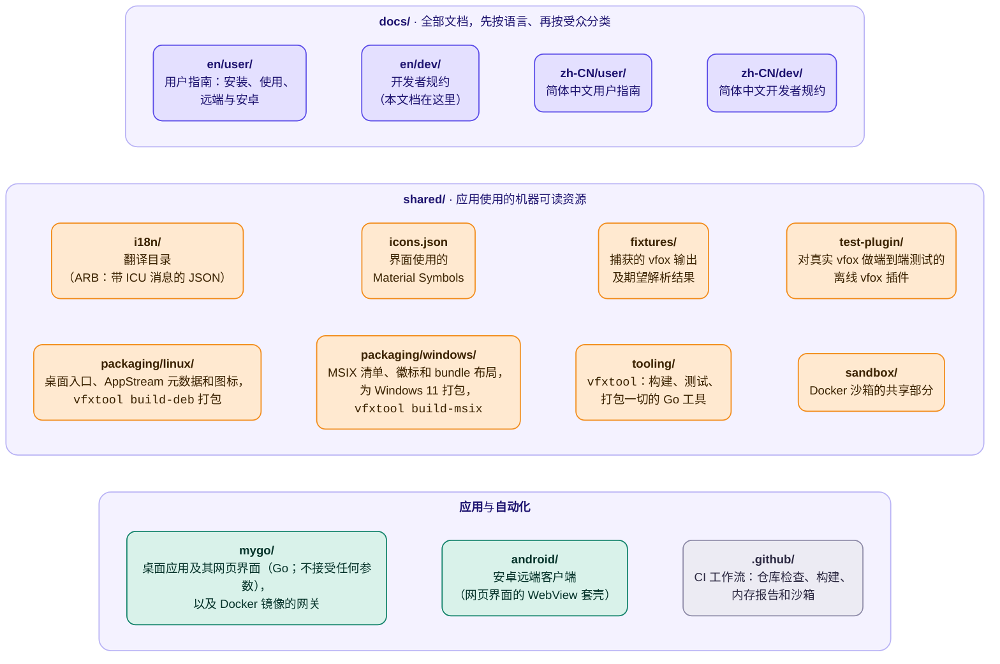
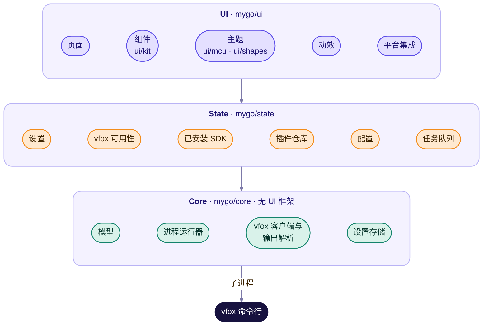
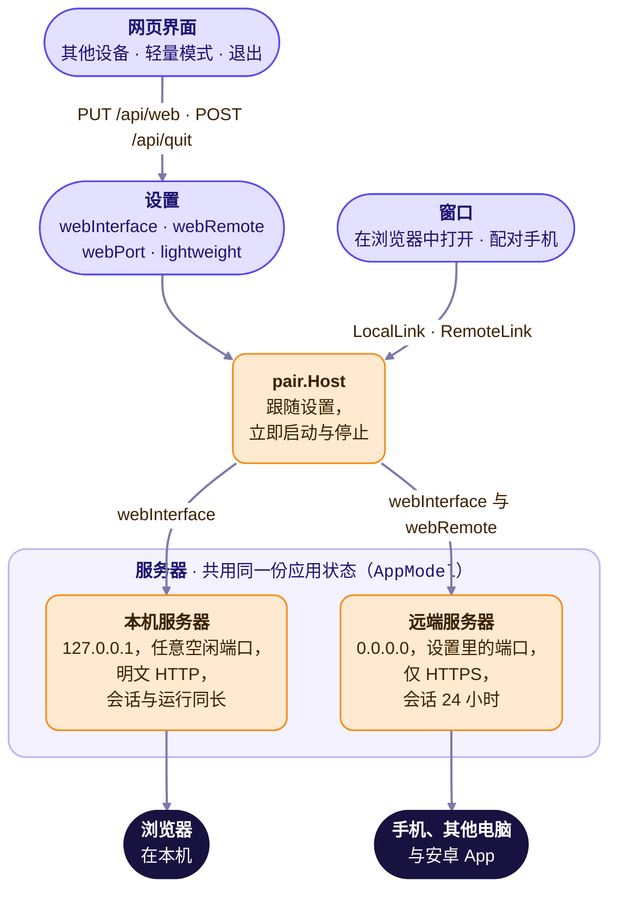
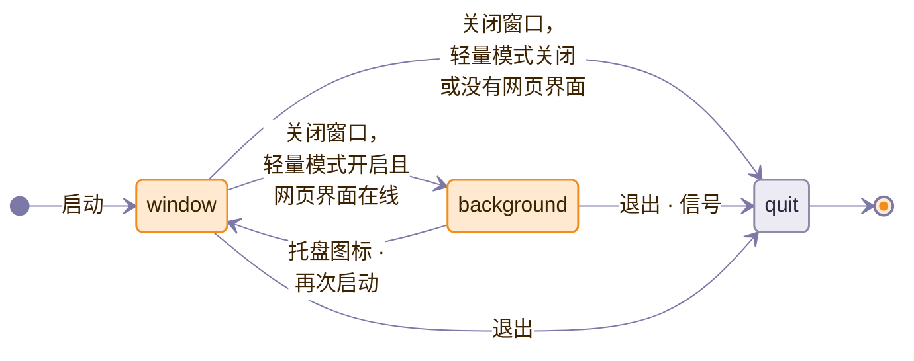

# 架构

> [English](../../en/dev/architecture.md)

vfox-plus 是 [vfox](https://vfox.dev) 命令行工具的图形化前端。它使用
[mygo](https://github.com/egoist/mygo)（Go 桌面应用框架）及其原生用户界面构建：
无 Web 视图、无 HTML、无 JavaScript。mygo 从 flexbox 布局的元素出发，用自研渲染器
绘制窗口，经 GTK 3 打开，无需 C 编译器。

## 仓库布局

应用从 `shared/` 读取共享资源，从不复制，保证翻译或夹具只改一处。

## 分层

应用分三层，依赖只向下。

**Core** 是不依赖 UI 框架的纯 Go，包含：

- 领域模型（`InstalledSdk`、`PluginInfo`、`AvailablePlugin`、
  `AvailableVersion`、`ConfigEntry`、`UseScope`）；
- *进程运行器*接口，按平台进程 API 实现；测试用脚本化替身，未来远端后端（见
  下）可提供另一实现；
- *vfox 客户端*：组装命令行、运行只读查询并解析输出，把改变状态的操作描述为
  *命令*（值）而不直接执行；
- *设置存储*；
- 带 ICU 消息的*翻译目录*（`core/i18n`）；
- *插件配置档案*（`core/profile`），见下。

它用 `shared/fixtures` 测试。

**State** 把 core 结果变成 UI 可观察状态。最重要的是*任务队列*：每个改变状态的
命令（安装、卸载、使用、取消使用、添加、移除、更新）都排队**一次执行一个**，
因为 vfox 不锁数据目录。每个任务流式输出进程内容、提取下载进度、保留有界日志
并总结失败。任务结束重载已安装 SDK。

**UI** 按[界面规约](ui-spec.md)和[设计系统](design-system.md)渲染状态。桌面集成
（浏览器、文件选择器、剪贴板、强调色）藏在小*平台服务*接口后，UI 测试可替换。
Material 3 Expressive 组件在 `ui/kit`，基于 mygo 元素与无样式部件；
配色（`ui/mcu`，Material 颜色工具的 Go 移植）与形状（`ui/shapes`，
`androidx.graphics.shapes` 的 Go 移植）和 `core`、`state` 一样是无 UI 框架的纯 Go。

源码中三层是 `mygo/core`、`mygo/state`、`mygo/ui`
（`ui/kit`、`ui/mcu`、`ui/shapes` 属 UI 层）；`core` 不知道其它层，`state` 只知道
`core`。

## 插件配置档案

vfox 对每个插件都用同样的方式列出、安装、选择与移除版本，但 version-fox 组织的插件提供的更多，
这些在 vfox 的输出里一点也看不出来：`vfox search java tem` 列出 Java 的一个发行版，而 `vfox search java`
只列出 OpenJDK；`nodejs@24` 安装最新的 Node.js 24，`flutter@stable` 安装某个通道的版本；每个插件还会读取
把下载指向镜像的环境变量与 `.nvmrc` 之类的版本文件。不了解这些，界面只能提供所有插件共有的功能，
第一版的 Web 界面就是这样只显示了 Java 的 OpenJDK 列表（[#43](https://github.com/version-fox/vfox-plus/issues/43)）。

*配置档案*（`core/profile`）把这些写成三个界面共用的纯数据，覆盖 `java`、`nodejs` 与 `flutter`：

| 部分 | 内容 |
| --- | --- |
| 搜索 | `vfox search` 里插件名后面的参数：`java` 有 Foojay 的 31 个发行版与 `all`（Linux loong64 上改为 Loongnix JDK），以及 vfox 不带参数时用的那个 |
| 简写 | `vfox install <插件>@<名称>` 除列出的版本外接受的名称 |
| 变量 | 插件读取的环境变量，附已检查过的镜像，以及每个变量接受什么（`http://` 或 `https://` 地址，或少数几个值） |
| 版本文件 | vfox 通过该插件读取的文件，以及 vfox 设置 `legacyVersionFile.strategy` 对它们是否有影响 |
| 筛选维度 | 适合已列出版本的备注与名称的筛选：`LTS`、`JavaFX`、Flutter 的通道与架构 |
| 命名 | 版本名称的构成，所以 `21.0.12.1+1-tem` 显示 Temurin，`3.47.7-x64` 显示 x64 |
| 说明、须知、文档 | 几句关于名称的说明、容易让人意外的地方，以及该插件文档的链接 |

档案里的文字用两种语言写在数据旁边，而不放进翻译目录，因为 Web 界面通过 HTTP 获取它们，页面本身也不带
翻译目录。没有档案的插件行为与从前相同。档案属于插件本身，而不是 vfox 称呼它的名字：用 `vfox add --alias` 添加的插件，
vfox 以别名称呼它，但 `vfox info` 仍会说出它是哪个插件，所以详情的控制器先按插件名查找档案，该名字没有档案时，
再按插件信息加载后报告的名字查找（详情页此时才出现“选项”标签，Web API 会等待插件信息）。注册表是
`state.AppModel.Profiles`；端到端测试为它们的离线测试插件注册了一份档案。

`SdkDetailController` 保存所选的搜索与所选筛选维度。`SetSearch` 会忘掉之前的列表与筛选维度（有人要列表时才
加载）；`ChooseSearch` 对用户所做的选择同样处理，并把它交给 `SearchMemory`，`AppModel` 用 `searches` 设置
实现它，所以选择在详情关闭和重启后仍在，各个界面也一致；档案仍提供该选择时，控制器从记住的选择开始。
`AppModel.SetPluginVariable` 按变量检查一个值，并把它存入设置里的额外环境变量，每个 vfox 进程都带着它运行。

## 与 vfox 对话

GUI 从不直接读写 vfox 文件，一切走命令行，见
[CLI 契约](vfox-cli-contract.md)。这让 GUI 跨 vfox 版本保持正确，也让 vfox 保持
自身不变式。契约还列出解析器必须容忍的现行 vfox 输出 quirks。

只读查询并发跑且便宜（每次约 10 ms）；只有 `vfox search` 和 `vfox available`
可能联网。

## 设置

GUI 自身设置存为 JSON：

- Linux：`$XDG_CONFIG_HOME/vfox-plus/settings.json`（默认
  `~/.config/vfox-plus/settings.json`）；
- Windows：`%APPDATA%/vfox-plus/settings.json`。

| 键 | 类型 | 默认 | 含义 |
| --- | --- | --- | --- |
| `theme` | string | `"system"` | `system`、`light` 或 `dark`。 |
| `useSystemColor` | boolean | `true` | 从桌面强调色派生颜色。 |
| `seedColor` | integer (ARGB) | `0xFFF28C1B` | 不用强调色时的种子颜色。 |
| `language` | string | `"system"` | `system`、`english` 或 `simplifiedChinese`。 |
| `vfoxExecutable` | string | 无 | vfox 路径；无表示自动探测。 |
| `extraEnvironment` | object | `{}` | 给 vfox 的额外环境变量，如镜像。 |
| `railExpanded` | boolean | `false` | 导航栏是否显示标签。 |
| `webInterface` | boolean | `false` | 应用运行期间，在回环服务器上向本机浏览器提供 Web 界面。缺省时读它的旧名 `remoteAccess`。 |
| `lightweight` | boolean | `false` | Web 界面在线时，关闭窗口后应用不退出，继续无窗口运行。 |
| `webRemote` | boolean | `false` | 同时允许网络中的其他设备通过 HTTPS 连接。仅在 `webInterface` 开启时有意义。 |
| `webPort` | integer | 无 | 其他设备连接的端口，1024 到 65535；无表示 8369。 |
| `webCertificate`、`webKey` | string | 无 | 其他设备得到的证书与私钥的 PEM 文件；无表示由应用自己生成证书。 |
| `searches` | object | `{}` | 为某个插件选择的搜索列表，以插件名为键：`{"java": "tem"}`。默认值没有条目。 |

未知键必须保留或忽略，不得拒绝。

vfox 配置（代理、仓库、存储目录等）**不是**这些设置的一部分：它属于 vfox，经
`vfox config` 编辑。

## 查找 vfox

未配置可执行文件时，GUI 先搜 `PATH`，再搜桌面启动器 `PATH` 常缺的常见安装位置：

- Linux：`/usr/local/bin`、`/usr/bin`、`~/.local/bin`、`~/bin`、
  `~/.linuxbrew/bin`、`/home/linuxbrew/.linuxbrew/bin` 和 `/snap/bin`，找 `vfox`；
- Windows：`%ProgramFiles%/vfox`、`%LOCALAPPDATA%/Programs/vfox`、
  `%LOCALAPPDATA%/Microsoft/WindowsApps`、`~/scoop/shims` 和 `~/.vfox/bin`，找
  `vfox.exe`（`PATH` 按 `;` 分隔）。

用户也可自选可执行文件。vfox 缺失或损坏时，GUI 说明如何安装，并保持设置可达。

## 依赖

运行时依赖必须属于 Apache 软件基金会许可证分类的 A 或 B 类
（见 <https://www.apache.org/legal/resolved>）：ASF 产品允许的即可——宽松许可证
（如 Apache-2.0、MIT、BSD、Unlicense）或弱 copyleft 许可证（如 MPL-2.0、
EPL-2.0）。X 类（GPL、AGPL 等强 copyleft）排除在外。
B 类依赖按自身许可证及其条件发布（声明保留、源码可得）；应用原样链接。应用框架
mygo 为 MIT 许可证，其链接的 Go 模块 purego 为 Apache License 2.0，文本塑形
`go-text/typesetting` 为 Unlicense 或 BSD，`golang.org/x` 模块与 Go 标准库为 BSD；
二维码编码器 `skip2/go-qrcode`（MIT）把设置里的配对链接编码成
二维码供安卓 App 扫描；`mygo/ui/mcu` 与 `mygo/ui/shapes` 中的移植代码来自 Apache License 2.0 与 MIT 许可证
的库，声明随应用发布（[`mygo/NOTICE.txt`](../../../mygo/NOTICE.txt)）。应用不链接 LGPL 的
GTK 3、GLib、Pango 和 Cairo：mygo 启动时从系统加载，包按
`vfxtool runtask`（`shared/tooling/internal/runtask`）声明依赖。Linux 上画托盘图标的
`libayatana-appindicator3` 也是如此：系统有它时 mygo 会加载，包只推荐、不依赖它。应用不含 X 类
强 copyleft 代码；若有 B 类弱 copyleft 依赖，按其许可证发布。`shared/tooling`
中的构建工具（`vfxtool`，不随应用发布）还用 `go-github`（内存报告的 GitHub API）、
`nfpm`（Debian 打包库）、`go-licenses`（许可证分类）、`go-getter`（带校验和的断点续传，用于包预取与图标的 npm 包）、`chromedp`
（启动 Chrome 并讲 DevTools Protocol，用于 Web 堆的测量与 Web 界面的截图，MIT）、`golang.org/x/image`
（绘制 Windows 徽标的矢量光栅化库，BSD-3-Clause）、`golang.org/x/tools`（覆盖率文件的解析器，
BSD-3-Clause）、`golang.org/x/sys`
（`vfxtool sign-msix` 的 Windows 调用：提权用的令牌、证书库；BSD-3-Clause）与 `godbus/dbus`（会话总线，端到端测试用它做
替身托盘宿主，以及向 GNOME Shell 提问；BSD-2-Clause），均为 A 类。图标是 Google 的 Material Symbols Rounded（Apache-2.0），由 `vfxtool prepare` 从
`shared/icons.json` 锁定的 npm 包 `@iconify-json/material-symbols` 切出：该包在构建时下载并校验，
不链接，只有所用符号的 SVG 被嵌入。
Windows `.msix` 与 `.msixbundle` 无额外运行时依赖：Go 可执行文件自包含，包自带徽标。
优先用平台与技术官方库而非第三方包，依赖声明旁注明用途。

## 内存

低内存占用是项目目标。应用：

- 列表懒加载（仅 Node.js 版本列表就近 900 条）；
- 每个已完成任务只在内存保留最新 500 行（运行时保留 2000 行），已完成任务
  最多记 50 条；失败任务的完整日志落盘，只保留最新 20 个文件；
- 只打包使用的图标（61 个符号，描边与填充各一，SVG 共约 70 KB，首次绘制时才解析）；
- 不可见动画停止，尊重平台的减少动态效果设置；
- 不缓存 vfox 可廉价重产的数据；
- 没有窗口时，告诉系统它暂时不要自己文件的页（常驻内存少 11 MB），Go 调度器最多用四个处理器，
  因为每个处理器都带着自己的内存缓存（见[内存页](memory.md#轻量模式)）。

[内存页](memory.md)记录应用占用。

## 远端前端

应用是桌面应用，没有命令行：不接受任何参数，它还做什么由设置决定。网页界面是其中一项。
`mygo/pair` 包放着它的服务器，由 `Host` 按设置运行；窗口和网页界面自己的页面都会改写这些设置。

- **网页界面**（`webInterface`）在回环接口的空闲端口上启动本机服务器，明文 HTTP：浏览器把回环源
  视为可信，所以始终带 `Secure` 的会话 cookie 在那里照样保留。窗口的*在浏览器中打开*在进程内
  为它生成一次性链接（`Host.LocalLink`）并用浏览器打开；链接应答会话 cookie 和到 `/app` 的重定向。
- **其他设备**（`webRemote`）在 `0.0.0.0` 和设置里的端口上起第二个服务器，只讲 HTTPS，没有
  证书 `pair.NewServer` 拒绝启动。证书是 `webCertificate` 与 `webKey` 指定的那一份，或由应用在设置旁
  为自己生成的（`EnsureServerCert`），设置里显示它的指纹供核对。*配对手机*为它生成链接
  （`Host.RemoteLink`），链接里带用户选的本机地址，并画成二维码（`pair.QRMatrix`）。关闭它会关掉
  服务器和它持有的所有连接，已配对页面的 server-sent events 也在内，会话随之结束。端口被占用，
  或证书加载失败，都不会停掉本机服务器：设置会说明其他设备为何连不上。
- **设置立即生效。**`Host` 监听设置并应用差异（`Host.Apply`）；它再通知自己的监听者，窗口据此
  重绘，网页界面的页面通过 `web` 事件得知。
- **两个服务器是两个安全域**：各有各的一次性令牌与会话，所以给本机浏览器的链接配不了手机，反之亦然。
  网页界面的页面可以改变其他设备如何连接并退出应用（`PUT /api/web`、`POST /api/quit`，仅限同源
  且已配对），但不能关掉网页界面本身，那会切断它正在用的连接。

### 窗口与轻量模式

每个用户运行一个应用。mygo 的 `RequestSingleInstanceLock` 让第二个应用把自己的启动转交给第一个
并结束，第一个打开窗口（`App.showWindow`），已有窗口则把它带到前台。端到端构建由测试启动，
无论机器上还有什么在运行，所以跳过这把锁。

关闭最后一个窗口（`OnWindowAllClosed`）会让应用退出，除非 `Settings.Lightweight` 开启且
`Host.Status().Running`。此时 `App.releaseWindow` 放掉窗口占用的全部东西（控件、页面、列表、任务上的监听、
本为窗口准备的工作），在托盘里放上图标（见[托盘](#托盘)），并把 Go 的内存还给系统，两秒后如果窗口仍关着，
再告诉系统它暂时不要自己文件的页（`App.scheduleTrim`，见
[内存页](memory.md#应用对文件页做了什么)）；之后打开的窗口从干净状态开始。任务、网页界面及其会话继续，因为它们不属于窗口。mygo 的界面库（GTK 3 及其库）仍留在内存里，所以轻量模式
只省几 MB，而不是大部分内存（见[内存页](memory.md#轻量模式)）。

即使两个模型同机并存（如两个用户的应用共用一个 vfox 数据目录，或端到端测试），变更命令依然
串行：每条任务在 vfox 进程运行时持有跨进程锁（设置旁 `tasks.lock`，`core.ProcessLock`），
进程内队列之外再加一道。

### 托盘

应用没有窗口时，由托盘里的一个图标代表它。它在应用测试的两种桌面上受支持：Windows 11，图标在通知区域；
GNOME，由 Shell 的 AppIndicator 扩展把它显示在面板里（Ubuntu 默认启用这个扩展）。其他桌面不受支持：
KDE Plasma 和托盘是旧式（XEmbed）的桌面，请用户换到 GNOME，或者不用这个图标，没有图标时应用照常运行。
代码并不拒绝它们（会话总线上有 StatusNotifierWatcher 且库在，就会创建图标；macOS 则是菜单栏），
但这些都没有测试，也不作承诺。菜单有*打开 vfox+*、*打开网页界面*（用一次性链接配对本机浏览器）和
*退出 vfox+*，激活图标会打开窗口。没有窗口的进程原本缺少的两样东西，回到窗口的路和结束应用的路，
由它提供。代码在 `mygo/ui/tray.go`。

- **何时。**`App.releaseWindow` 在放掉窗口时创建图标（`showTray`），`App.openWindow` 把它移除
  （`hideTray`），所以应用有窗口时没有图标，内存最要紧的那个状态不为它占用任何东西。
- **与窗口一样是一道接缝。**`desktop.newTray` 接收 `trayOptions`（PNG、提示文字、由标签与点击组成的
  条目、以及激活时做什么），返回 `trayIcon`（`Update`、`Destroy`）。`newNativeTray` 才调用
  `mygo.NewTray`；测试用一个记录器（`fakeTray`）替换它，并由它点击条目。
- **回到窗口靠菜单，不靠点击。**Linux 上点击图标显示菜单。`OnClick` 监听的激活，在 Windows 是左键点击，
  在 GNOME 是双击，且只有库带 `activate` 信号时才有，Ubuntu 26.04 的 libayatana-appindicator3
  （0.5.94）没有：面板的 `Activate` 调用会失败，面板转而显示菜单。
- **必须有宿主。**会话总线上没有 StatusNotifierWatcher 时，libayatana-appindicator3 回退到
  `GtkStatusIcon`，如今没有面板会显示它，还要通过桌面的图像加载器解码图标的图片来创建它：白白花 7 MB
  内存。`trayHostAvailable`（`platform_linux.go`）先问会话总线，用的是一个不许启动服务的
  `org.kde.StatusNotifierWatcher` 的 `GDBusProxy`，名字没有主人时 `newNativeTray` 就不创建图标。
- **没有托盘不算错误。**没有宿主、没有 `libayatana-appindicator3`、`NewTray` 失败：日志里一行
  （"no icon in the tray: ..."），应用不带图标继续运行。再次启动它或用网页界面，仍是回到窗口的路。
- **移除。**图标由一个 goroutine 在请求窗口的那次选择返回之后移除，因为桌面的库不指望菜单项的
  所有者在该项的处理函数里消失（`hideTray`）；应用结束时则立即移除（`OnWillQuit` → `removeTray`），
  因为 Windows 会一直显示已经退出的程序的图标，直到指针划过。
- **语言。**标签使用设置里的语言，而网页界面可以在没有窗口可画时修改它：设置上的一个监听
  （`refreshTray`）在语言变了时重写菜单。
- **图片。**`tray.png` 32×32 像素，是应用图标的狐狸，不带底板（橙色在浅色和深色面板上都看得清）。
  仓库里不放图片，所以由 `vfxtool prepare` 用 `appicon.RenderFox` 绘制，`mygo/assets` 内嵌，
  与其他收集来的资源一样被 git 忽略。
- **打包。**什么也不链接：系统有 `libayatana-appindicator3` 时，mygo 启动时打开它（见
  [依赖](#依赖)）。Debian 包推荐 `libayatana-appindicator3-1` 而不依赖它，安装测试不装推荐包，
  证明没有它应用照常运行。

图标的内存开销见[内存页](memory.md#托盘图标)。它在四个层面上测试：

- **逻辑**：`ui` 的单元测试，把托盘换成一个记录器（`fakeTray`），由它选择条目。
- **协议**：用一个替身托盘宿主，CI 的运行器需要它，因为运行器没有面板：工具链的 `trayhost` 包在会话总线上拥有
  `org.kde.StatusNotifierWatcher`，像 GNOME 的 AppIndicator 扩展那样读取条目及其 dbusmenu，并选择条目
  （godbus，BSD-2-Clause，是它唯一的依赖）。`vfxtool e2e-run tray`（`build` 任务的一步）关闭窗口，检查图标、它的
  提示文字、图片（32×32 的 PNG，狐狸，无底板）和菜单；选*打开 vfox+*（窗口回来，图标消失）；选*打开网页界面*
  （一个注册为网页链接处理程序的、代替用户浏览器的程序收到一个能配对的链接）；从菜单退出（应用以 0 结束，图片
  所在目录被删除）。然后在没有宿主的地方再运行一次应用，检查它不创建图标并说明原因，这样库的回退就被挡在外面。
- **Shell**：用真正的 GNOME Shell。`vfxtool gnome-session` 在 `shared/sandbox/gnome.Dockerfile` 的容器里，在没有
  屏幕的 Ubuntu GNOME Shell 50（mutter 无需 GPU 就能提供 Wayland）里运行一条命令，并启用 AppIndicator 扩展；
  `vfxtool e2e-run tray-gnome`（`tray-gnome` 任务运行）是对着它的场景：应用关闭窗口，Shell 在面板里为它放一个
  指示器并为它生成菜单（用 `org.gnome.Shell.Eval` 读取，Shell 在不安全模式下提供它），像用户那样选择
  *打开 vfox+*、*打开网页界面* 和 *退出 vfox+*，做法是让扩展发出点击事件，应用照做；窗口回来时 Shell 隐藏图标，
  应用结束时它把图标撤掉，这一切之后 Shell 仍在运行。
- **Windows**：`run-windows` 任务在 Windows Server 2025（x64）与 Windows 11 ARM 上，用 Windows 的端到端构建，
  在运行器的桌面上（那里有 `explorer.exe` 及其任务栏）运行 `vfxtool e2e-run fake` 与 `vfxtool e2e-run tray`。
  窗口回来、应用结束按端到端构建的控制文件的要求发生，因为点击任务栏的图标不是程序该做的事。图标的位置由应用向桌面
  询问（mygo 的 `Tray.Bounds`，即 `Shell_NotifyIconGetRect`），应用为它创建的每个图标把答案写进日志：在
  Windows Server 2025 上，图标两次创建都在通知区域得到了位置。桌面能不能说出图标在哪，由场景自己添加的一个普通图标
  来查明，用 `Shell_NotifyIconW` 和每个程序都用的结构（`tray_windows_probe.go`），应用的图标拿它来对照。在 Windows 11
  ARM 的运行器上，shell 不接受任何程序的图标（连那个普通图标也被这个调用拒绝，而 `explorer.exe` 及其任务栏与测试在
  同一个桌面、会话和用户下），所以那里不检查图标的位置：场景用一条 NOTE 说明，并检查能检查的，也就是窗口和应用。
  场景的第一行会说它运行在哪个 Windows 上。

控制文件是端到端构建的 `VFOX_PLUS_E2E_CONTROL`：工具往里写 `close`、`show` 或 `quit`，应用就做用户用关闭按钮和
菜单的两个条目所做的事，并把文件删掉。mygo 的自动化插件没有关闭窗口的办法，Windows 也没有可发的信号。

### 网页界面与安卓客户端

服务器（`mygo/pair` 包）提供一次性链接与会过期的会话。配对后的浏览器在
`/app` 得到完整 Web 界面：已安装 SDK 的安装/使用/卸载、插件仓库的添加/更新/
删除、带 server-sent events 实时进度与日志的任务、以及设置。Web 界面使用的 HTTP 接口见
[远端协议](remote-protocol.md)。

Android 客户端（`android/`）连同一个服务器：它是包住 `/app` 的 WebView，
配对流程是原生 Material 3 Expressive（粘贴或扫描设置里的配对链接、核对证书指纹），
手机以此驱动 PC 上的 vfox-plus 实例。Web 界面本身遵循
[设计系统](design-system.md)（种子色、形状、动效），资源全部内联（favicon 也是），
因为服务器只提供单个无外部请求的嵌入页面。`/manifest.webmanifest` 的 Web 应用清单
让 Chromium 系浏览器能把该页面安装为应用，图标相同。

### 网关

Docker 镜像（`mygo/Dockerfile`）是远端服务器的第二种客户端，与安卓 App 并列，而不是应用的一个实例。它的程序
是 `mygo/cmd/vfox-plus-gateway`，不接受任何参数；它的包是 `mygo/gateway`。它用 `mygo/pair` 的证书与指纹，
不用窗口、界面库和 vfox，所以不需要 cgo 就能构建成一个约 10 MB 的静态二进制，镜像就是这个二进制放在
`scratch` 上，再加机构证书和用户 10001 的主目录。想通过自己选定的地址（比如容器主机）使用某个 vfox-plus
界面的人，把网关配对给它。

- **两次配对，按协议来。** 浏览器用一次性链接（`/auth/connect/<token>`，五分钟，网关启动时打印）与网关配对，
  并持有自己的会话。它的 cookie 是 `vfox-plus-gateway` 而不是 `vfox-plus-session`：cookie 属于主机而不属于
  端口，同一主机上网关与实例的 cookie 否则就成了同一个。网关与实例配对的方式和安卓 App 一样：人把实例的
  配对链接粘贴到网关的页面上，网关查看证书（`certificateOf`），拿到的会话 cookie 归网关所有。系统根证书
  担保的证书直接信任；应用自己生成的证书则以指纹显示，与应用设置里的核对，只有人说两者一致才信任并固定。
  任何连接都不会跳过证书校验（不使用 `InsecureSkipVerify`）：被查看的证书取自一次校验失败的连接的错误，其中
  有对方出示的证书；被固定的证书保存在网关的状态里，并成为连到那个实例的连接的唯一根证书，所以它像任何证书
  一样被校验，有效期和用途也在内，所用的名字是它自己有的（应用把这台电脑的各个地址写进了证书，而网关可能用
  另一个地址到达这台电脑）。被信任的就是展示过的那个证书：人同意时会再看一次，不同的会被拒绝。之后证书若
  变了，就不会带着网关的会话去连，并带着警告再次询问。明文 HTTP 只用于应用提供它的回环地址。
- **网关自己提供什么，什么属于实例。** 页面 `/`、`/auth/connect/`、`/api/token` 和 `/gateway/` 下的表单属于
  网关（见[远端协议](remote-protocol.md#网关)）。`/app`、`/api/*` 和 `/manifest.webmanifest` 属于实例，由
  `httputil.ReverseProxy` 带着网关的会话转发，所以页面就是实例自己的，总与它调用的路由相符。事件随到随发。
  代理从请求里去掉属于浏览器和网关、不属于实例的东西（cookie、`Origin`、`Referer`、`Authorization`、
  `Forwarded`、`X-Forwarded-*`、`X-Real-Ip` 和 `Sec-Fetch-*`：实例会拒绝来源指向另一台主机的修改，而网关在转发前
  已用 `http.CrossOriginProtection` 按自己的来源检查过），并去掉应答里的 `Set-Cookie`。
- **保持配对。** 实例的会话 24 小时，随实例结束。`keepPaired` 在网关启动时和之后每六小时续期一次：用
  `GET /api/token`（已配对设备可以为第二台设备生成链接），再用那个链接配对；连不上的实例五分钟后重试，会话
  保留，因为实例可能在会话结束前恢复；实例返回 `401` 就把会话标记为结束（`invalidate`），网关的页面
  请人给新链接。请求总以开始时的实例和会话结束，哪怕网关中途重新配对了。
- **它记住什么。** `gateway.json`（权限 `0600`：里面有它在实例处的会话，和人核对过的实例证书）和网关自己的证书——由
  `pair.EnsureServerCert` 生成的 `serve-cert.pem` 与 `serve-key.pem`，或人放进去的 `cert.pem` 与 `key.pem`——都在
  用户配置目录的 `vfox-plus-gateway` 下（镜像里是一个卷）。浏览器的会话不记：重新启动的网关会打印新链接。
- **停止。** 页面的事件永不结束，开着界面的浏览器会让 `docker stop` 等满整个宽限期：网关让在途的请求再
  完成一秒，然后以代码 0 结束。
- **测试。** 包测试让网关对着 `mygo/pair` 的真实服务器运行，包括明文 HTTP 和用应用生成的证书的 HTTPS。
  `vfxtool gateway-check` 让镜像（或程序）对着应用本身运行（见[实现指南](implementation-mygo.md)）。
