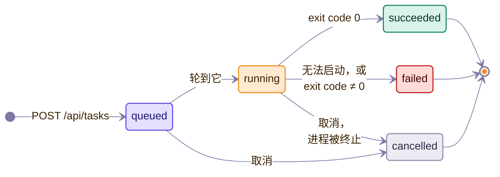

# 远端协议

> [English](../../en/dev/remote-protocol.md)

本文规定配对服务（`mygo/pair`，`vfox-plus pair` / `vfox-plus serve`）的 HTTP
接口：Web 界面（`mygo/pair/webapp.html`）与 Android 客户端（`android/`）都按它
编程。实现在 `mygo/pair/pair.go`（`Server`）、`web.go` 与 `webapi.go`。

## 概念

- **配对链接**是一次性 URL `/auth/connect/<token>`。令牌一次性有效，
  `--token-ttl` 后过期（默认 5 分钟）。打开即配对：服务返回
  `Set-Cookie: vfox-plus-session=<session>`（`Secure`、`HttpOnly`、
  `SameSite=Lax`）。
- **会话** cookie 认证除 `/`、`/auth/connect/*` 与 `/manifest.webmanifest` 外的所有路由。`serve` 会话
  `--session-ttl` 后过期（默认 24 小时）；过期会话返回 401，需重新配对。
- 写操作路由在调用方携带 `Origin`/`Referer` 时要求同源；两者都不带（如 curl）
  凭会话 cookie 直接放行。
- 每个用户一个**共享服务**拥有应用状态：桌面运行时内嵌一个，`service start`
  的 daemon 或回环 `serve` 登记自己为共享服务，`pair` 从活着的那个增发。发现文件是设置旁的 `server.json`
  （`{"pid", "port", "adminToken", "owner", "startedAt"}`，0600）；发现时删掉
  过期文件。无活 server 的 `pair` 起自己的只读快照服务，除非服务已禁用
  （`service.json`，`{"disabled": true}`）。
- **管理 bearer** 在回环上无会话增发链接：`pair` 与回环 `serve` 从发现文件读
  令牌，以 `Authorization: Bearer <token>` 调 `GET /api/token`。非回环连接
  即使令牌正确也拒绝，且它永不变成 cookie。
- `pair` 模式只提供配对流程与只读快照。下述路由需要拥有 `AppModel` 的 `serve`
  模式。

## 配对

| 方法与路径 | 认证 | 含义 |
| --- | --- | --- |
| `GET /` | 无 | 介绍页，绝口不提令牌。 |
| `GET /auth/connect/<token>` | 令牌 | 消费令牌、种会话 cookie、渲染结果页。无效、已用或过期令牌返回 403。 |
| `GET /api/status` | 会话 | 只读快照（`pair` 模式）：`{hasVfox, vfoxVersion?, vfoxError?, sdks[]}`，`sdks[] = {name, current, hasCurrent, versions[]}`。 |
| `GET /api/token` | 会话，或回环管理 bearer | 为第二个浏览器（或本机 CLI）增发一次性配对链接：`{url}`，按调用方 host 渲染。 |

终端上，非回环监听的 `vfox-plus serve` 还把配对链接打印成二维码
（`mygo/pair.TerminalQRCode`），地址取可达局域网地址
（`ReachablePairingURL`），供安卓 App 扫描免输入。回环监听只打文本：手机
反正连不上。远端访问默认关闭：`serve` 无显式 `--allow-remote` 时拒绝非回环
监听（发布 Docker 镜像经其 `CMD` opt-in）。

## Web 界面

`GET /app`（仅会话，否则跳 `/`）提供单个嵌入页面：无外部请求、资源全内联、
`Cache-Control: no-store`。遵循[设计系统](design-system.md)（种子色、形状、动效），
图标为内联 SVG。

`GET /manifest.webmanifest`（无需会话）提供 Web 界面的 Web 应用清单
（`application/manifest+json`，`Cache-Control: no-cache`）：`name` 与 `short_name`
为 `vfox+`，`id` 与 `start_url` 为 `/app`，`scope` 为 `/`，`display` 为
`standalone`，颜色取自页面，图标只有一个：favicon，尺寸 `any` 的 SVG data URI。
Chromium 系浏览器据此提示把 Web 界面安装为应用。它无需会话，因为只写明应用名
与起始页，而且浏览器可能不借助链接它的页面就处理清单（规范提到了从同步服务安装），
那时没有会话 cookie。

## 总览

`GET /api/inventory`（会话，仅 `serve`）一次返回已安装 SDK、插件仓库与 vfox
配置。每节自带加载与错误状态，与桌面界面一致：

```json
{
  "vfox": {"availability": "available|missing|broken", "version": "1.0.13", "error": ""},
  "installed": {"loading": false, "value": [{"Name": "nodejs", "Versions": ["24.11.1"], "Current": "24.11.1", "HasCurrent": true}]},
  "registry": {"loading": false, "value": [{"Name": "nodejs", "Homepage": "https://…", "Official": true}]},
  "config": {"loading": false, "value": [{"Key": "proxy.enable", "Value": "false"}]},
  "complete": true
}
```

字段名沿用 Go 模型（`core.InstalledSdk`、`core.AvailablePlugin`、
`core.ConfigEntry`）；`complete` 表示三节是否都在加载超时（2 分钟）内完成。

## SDK 详情

| 方法与路径 | 含义 |
| --- | --- |
| `GET /api/sdks/<name>/info` | 插件元数据（`core.PluginInfo`）：`{Name, Version, Homepage, InstallPath, Description}`。未知插件 404；vfox 失败 502。 |
| `GET /api/sdks/<name>/versions[?search=<value>]` | 可安装版本（`core.AvailableVersion[]`）：`{Version, Note, HasNote, Additions: [{Name, Version}], Installed}`。`search` 是插件[配置档案](#插件配置档案)里某个选择项的值（`java` 是发行版的简称，或 `all`），成为 `vfox search` 的参数；未知的值，以及没有此类选择的插件收到任何值，都回答 400。有档案的插件，每个版本还带 `parts`（拆开的名称：`{version, source: {value, name: {en, zh}}, flavors}`）与 `facets`（`{<维度 id>: [值]}`，为空时省略），这样页面不需要自己的规则。搜索可能耗时数秒；超时 504。 |
| `GET /api/sdks/<name>/profile` | 插件的配置档案，见下。没有档案的插件回答 404。 |
| `PUT /api/sdks/<name>/variables` | 设置档案里列出的一个环境变量：`{key, value}`，值为空即取消。插件不读取的变量、它不接受的值与没有 key 的请求体回答 400 并附原因，没有档案的插件回答 404。值会加入设置里的额外环境。 |

### 插件配置档案

`GET /api/sdks/<name>/profile` 回答应用对该插件了解的内容（`mygo/core/profile`，见[架构](architecture.md#插件配置档案)）。
每段文字都有两种语言，`{"en": …, "zh": …}`（`zh` 与 `en` 相同时省略），页面按自己的语言设置选择：

```json
{
  "plugin": "java", "naming": "java",
  "search": {"label": {"en": "Distribution", "zh": "发行版"}, "default": "open",
             "choices": [{"value": "tem", "name": {"en": "Temurin"}, "maker": {"en": "Eclipse Adoptium"}, "aliases": ["temurin"], "popular": true}]},
  "shorthands": [{"name": "21-tem", "meaning": {"en": "The newest Temurin 21", "zh": "最新的 Temurin 21"}}],
  "variables": [{"key": "VFOX_JAVA_GITHUB_MIRROR", "label": {"en": "GitHub mirror"}, "help": {"en": "…"},
                 "kind": "url", "presets": [{"value": "https://gh-proxy.org/", "name": {"en": "gh-proxy"}}], "example": "https://gh-proxy.org/", "value": ""}],
  "legacyFiles": [".sdkmanrc"], "legacyStrategy": false,
  "facets": [{"id": "support", "label": {"en": "Support"}, "values": ["LTS"]}],
  "guide": {"en": "…"}, "tips": [{"en": "…"}], "docs": [{"title": {"en": "Versions and names"}, "url": {"en": "https://…"}}],
  "installed": {"21.0.12.1+1-tem": {"version": "21.0.12.1+1", "source": {"value": "tem", "name": {"en": "Temurin"}}, "flavors": []}}
}
```

`variables[].value` 是 vfox 现在运行时用的值，`installed` 把已安装版本的名称拆开。`naming` 是 `java`、`flutter` 或 `plain`。

## 任务

任务生命周期：



同一时刻只跑一条变更命令，其余排队。队列是进程内的，每条任务还在 vfox 进程
运行时另持跨进程文件锁（设置旁 `tasks.lock`），桌面与 LAN `serve` 并存时变更
依然串行。

| 方法与路径 | 含义 |
| --- | --- |
| `GET /api/tasks` | 列出任务，最新在前，每条带最新 50 行日志。 |
| `POST /api/tasks` | 启动任务：`{operation, sdk?, version?, scope?, source?, alias?}`。201 返回该任务。 |
| `GET /api/tasks/<id>` | 单条任务，带最新 500 行日志。 |
| `GET /api/tasks/<id>/log` | 失败任务保留的完整日志，纯文本（未保留返回 404）。 |
| `POST /api/tasks/<id>/cancel` | 取消排队或运行中的任务。 |
| `POST /api/tasks/<id>/retry` | 重跑已结束的任务。 |
| `DELETE /api/tasks/finished` | 清除已结束任务：`{cleared: true}`。 |

任务形如（完整输出保留在磁盘上时带 `hasFullLog`）。队列把每个运行中的任务
完整输出落盘到系统用户缓存（`vfox-plus/tasks`），单文件封顶、只保留最新
20 个；仅失败任务保留，成功与取消的删除，被遗忘的已结束任务连文件一起删：

```json
{"id": 3, "operation": "install", "sdk": "nodejs", "version": "24.11.1",
 "commandLine": "vfox install --yes nodejs@24.11.1", "status": "running",
 "progress": 0.42, "createdAt": "…", "startedAt": "…",
 "log": ["…"], "droppedLines": 0}
```

操作：`install`（sdk + version）、`uninstall`（sdk + version）、`use`
（sdk + version，仅 `global` 作用域——浏览器说不出跑 vfox 机器上的目录）、
`unuse`（sdk）、`add`（远端 URL `source` + 可选 `alias`；本地路径拒绝）、
`remove`（sdk）、`update`（sdk，空即 `--all`）。未知操作与缺字段返回 400。

## 插件

`POST /api/plugins`（会话，需同源）从 JSON 体 `{source, alias?}`（仅远端 URL）
或 `multipart/form-data` 上传（`file` 加可选 `alias`，至多 33 MiB）添加插件。
上传写入模式 `0600` 的私有目录，由任务终结器删除。201 返回该任务。

## 设置与 vfox 配置

| 方法与路径 | 含义 |
| --- | --- |
| `GET /api/settings` | 可编辑的 GUI 设置：`{vfoxExecutable, extraEnvironment, language}`。 |
| `PUT /api/settings` | 更新它们（`language` 为 `system`、`english` 或 `simplifiedChinese`）。未知语言 400。 |
| `PUT /api/config` | 设置一个 vfox 键：`{key, value}`。vfox 失败 502 并带其消息。 |
| `DELETE /api/config?key=<key>` | 重置一个 vfox 键为默认。 |

## 事件

`GET /api/events`（会话）是 server-sent-events 流。消息为 `event: <kind>` 加空
JSON 负载；客户端按类型重拉变化的内容。类型：`hello`（连接后）、`task`、
`inventory`、`vfox`。每 25 秒 `: ping` 心跳注释，防止代理掐掉空闲连接。

## TLS

非回环监听一律 HTTPS。未传 `--tls-cert/--tls-key` 时服务首次启动在设置旁生成
自签名证书对（`mygo/pair/tlscert.go`）并打印 SHA-256 指纹。浏览器与安卓 App 在
信任证书前必须展示该指纹供核对。自带证书可免去警告。会话 cookie 恒为
`Secure`：回环来源可信，浏览器在纯 HTTP 回环上也会送回它。

## Android 客户端

`android/` 是包住本协议的薄原生套壳：

- **配对流程**是原生的（Material 3 Expressive）：粘贴配对链接（或扫码）、展示
  TLS 指纹供核对、持久化会话 cookie。
- **主内容**是 `/app` 的 WebView，打开文件上传（供插件 `.zip`/`.lua` 文件），
  下拉等交互留给页面。
- 它按本文档编程，不直连 Go 代码：列表用总览，进度用 `/api/tasks` +
  `/api/events`，动作用 POST 路由。
