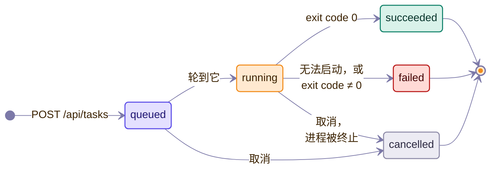

# 远端协议

> [English](../../en/dev/remote-protocol.md)

本文规定网页界面的服务器（`mygo/pair`，应用在设置要求时运行）的 HTTP 接口：Web 界面
（`mygo/pair/webapp.html`）与 Android 客户端（`android/`）都按它编程。实现在
`mygo/pair/pair.go`（`Server`）、`host.go`（`Host`）、`web.go` 与 `webapi.go`。

## 概念

- **配对链接**是一次性 URL `/auth/connect/<token>`。令牌一次性有效，5 分钟后过期。
  打开即配对：服务返回 `Set-Cookie: vfox-plus-session=<session>`（`Secure`、`HttpOnly`、
  `SameSite=Lax`）和到 `/app` 的重定向（`303`）。链接由应用生成：设置里的*在浏览器中打开*与
  *复制链接*给本机的浏览器，*配对手机*给网络中的设备。
- **会话** cookie 认证除 `/`、`/auth/connect/*` 与 `/manifest.webmanifest` 外的所有路由。给其他设备的
  服务器的会话 24 小时后过期；本机服务器的会话与应用运行同长。过期会话返回 401，需重新配对。
- 写操作路由另外拒绝浏览器的跨源请求，用 `net/http` 的跨源保护：`Sec-Fetch-Site`
  不是 `same-origin`（或 `none`），或没有该头时 `Origin` 的主机与所请求的主机不同，
  返回 403。两个头都不带（如 curl）的请求凭会话 cookie 直接放行。
- 两个**服务器**共用同一份应用状态，各有各的令牌与会话（见[架构](architecture.md#远端前端)）。
  **本机服务器**在设置 `webInterface` 开启时监听 `127.0.0.1` 的空闲端口，明文 HTTP。
  **远端服务器**在 `webRemote` 也开启时监听 `0.0.0.0` 和设置 `webPort`（默认 8369）的端口，
  仅 HTTPS。关闭一项设置会关掉对应服务器和它持有的所有连接；该服务器的会话随之结束。
  重启应用后配对不保留。
- 网页界面的页面可以读取并修改其他设备如何连接、应用在没有窗口时是否继续运行，也可以退出应用
  （`/api/web`、`/api/quit`）；它们不能关掉网页界面本身。

## 配对

| 方法与路径 | 认证 | 含义 |
| --- | --- | --- |
| `GET /` | 无 | 介绍页，说明去哪里拿链接（应用的设置）。绝口不提令牌。 |
| `GET /auth/connect/<token>` | 令牌 | 消费令牌、种会话 cookie、重定向到 `/app`。无效、已用或过期令牌返回 403。 |
| `GET /api/token` | 会话 | 为第二个浏览器增发一次性配对链接：`{url}`，按调用方 host 渲染。 |

设置里的配对二维码是远端服务器的配对链接，链接里带本机在某个网络上的地址（`Host.RemoteLink`），
画成二维码（`mygo/pair.QRMatrix`；Web 界面的页面通过 `POST /api/web/pairing` 拿到 SVG 形式），
供安卓 App 扫描免输入。其他设备默认关闭：设置在把电脑开放给网络之前先要求确认。

## Web 界面

`GET /app`（仅会话，否则跳 `/`）提供单个嵌入页面：无外部请求、资源全内联、
`Cache-Control: no-store`。遵循[设计系统](design-system.md)（种子色、形状、动效），
图标为内联 SVG。

`GET /manifest.webmanifest`（无需会话）提供 Web 界面的 Web 应用清单
（`application/manifest+json`，`Cache-Control: no-cache`）：`name` 与 `short_name`
为 `vfox+`，`id` 与 `start_url` 为 `/app`，`scope` 为 `/`，`display` 为
`standalone`，颜色取自页面，图标只有一个：favicon，尺寸 `any` 的 SVG data URI。
Chromium 系浏览器据此提示把 Web 界面安装为应用。它无需会话，因为只写明应用名
与起始页，而且浏览器可能不借助链接它的页面就处理清单（规范提到了从同步服务安装），
那时没有会话 cookie。

## 总览

`GET /api/inventory`（会话）一次返回已安装 SDK、插件仓库与 vfox
配置。每节自带加载与错误状态，与桌面界面一致：

```json
{
  "vfox": {"availability": "available|missing|broken", "version": "1.0.13", "error": ""},
  "installed": {"loading": false, "value": [{"Name": "nodejs", "Versions": ["24.11.1"], "Current": "24.11.1", "HasCurrent": true}]},
  "registry": {"loading": false, "value": [{"Name": "nodejs", "Homepage": "https://…", "Official": true}]},
  "config": {"loading": false, "value": [{"Key": "proxy.enable", "Value": "false"}]},
  "complete": true
}
```

字段名沿用 Go 模型（`core.InstalledSdk`、`core.AvailablePlugin`、
`core.ConfigEntry`）；`complete` 表示三节是否都在加载超时（2 分钟）内完成。

## SDK 详情

| 方法与路径 | 含义 |
| --- | --- |
| `GET /api/sdks/<name>/info` | 插件元数据（`core.PluginInfo`）：`{Name, Version, Homepage, InstallPath, Description}`。未知插件 404；vfox 失败 502。 |
| `GET /api/sdks/<name>/versions[?search=<value>]` | 可安装版本（`core.AvailableVersion[]`）：`{Version, Note, HasNote, Additions: [{Name, Version}], Installed}`。不带 `search` 时，插件列出用户所做的选择（`PUT .../search` 保存的；没做选择则是插件的默认值）。`search` 是插件[配置档案](#插件配置档案)里某个选择项的值（`java` 是发行版的简称，或 `all`），仅对这一次请求成为 `vfox search` 的参数；未知的值，以及没有此类选择的插件收到任何值，都回答 400。有档案的插件，每个版本还带 `parts`（拆开的名称：`{version, source: {value, name: {en, zh}}, flavors}`）与 `facets`（`{<维度 id>: [值]}`，为空时省略），这样页面不需要自己的规则。搜索可能耗时数秒；超时 504。 |
| `GET /api/sdks/<name>/profile` | 插件的配置档案，见下。没有档案的插件回答 404。 |
| `PUT /api/sdks/<name>/search` | 选择插件列出什么：`{value}`，档案里某个选择项的值；插件的默认值也是一个选择，空值即默认值。应用把选择保存在设置里，从此插件列出的就是它，各个界面一致，重启后仍在。回答 `{value}`，即现在的选择。未知的值与没有 value 的请求体回答 400，搜索不带参数的插件（以及没有档案的插件）回答 404。 |
| `PUT /api/sdks/<name>/variables` | 设置档案里列出的一个环境变量：`{key, value}`，值为空即取消。插件不读取的变量、它不接受的值与没有 key 的请求体回答 400 并附原因，没有档案的插件回答 404。值会加入设置里的额外环境。 |

### 插件配置档案

`GET /api/sdks/<name>/profile` 回答应用对该插件了解的内容（`mygo/core/profile`，见[架构](architecture.md#插件配置档案)）。
每段文字都有两种语言，`{"en": …, "zh": …}`（`zh` 与 `en` 相同时省略），页面按自己的语言设置选择：

```json
{
  "plugin": "java", "naming": "java",
  "search": {"label": {"en": "Distribution", "zh": "发行版"}, "default": "open", "current": "tem",
             "choices": [{"value": "tem", "name": {"en": "Temurin"}, "maker": {"en": "Eclipse Adoptium"}, "aliases": ["temurin"], "popular": true}]},
  "shorthands": [{"name": "21-tem", "meaning": {"en": "The newest Temurin 21", "zh": "最新的 Temurin 21"}}],
  "variables": [{"key": "VFOX_JAVA_GITHUB_MIRROR", "label": {"en": "GitHub mirror"}, "help": {"en": "…"},
                 "kind": "url", "presets": [{"value": "https://gh-proxy.org/", "name": {"en": "gh-proxy"}}], "example": "https://gh-proxy.org/", "value": ""}],
  "legacyFiles": [".sdkmanrc"], "legacyStrategy": false,
  "facets": [{"id": "support", "label": {"en": "Support"}, "values": ["LTS"]}],
  "guide": {"en": "…"}, "tips": [{"en": "…"}], "docs": [{"title": {"en": "Versions and names"}, "url": {"en": "https://…"}}],
  "installed": {"21.0.12.1+1-tem": {"version": "21.0.12.1+1", "source": {"value": "tem", "name": {"en": "Temurin"}}, "flavors": []}}
}
```

`variables[].value` 是 vfox 现在运行时用的值，`installed` 把已安装版本的名称拆开。`search.current` 是插件现在列出的选择项的值。
`naming` 是 `java`、`flutter` 或 `plain`。

用别名添加的插件（`vfox add --alias coffee java`）在 `/api/sdks/<name>/…` 的每个路径里都以别名称呼，并带有它所自出插件的档案：
服务器用 `vfox info` 问出它是哪个插件。它的搜索选择以别名为键保存。

## 任务

任务生命周期：



同一时刻只跑一条变更命令，其余排队。队列是进程内的，每条任务还在 vfox 进程
运行时另持跨进程文件锁（设置旁 `tasks.lock`），两个用户的应用共用一个 vfox 数据目录时变更
依然串行。

| 方法与路径 | 含义 |
| --- | --- |
| `GET /api/tasks` | 列出任务，最新在前，每条带最新 50 行日志。 |
| `POST /api/tasks` | 启动任务：`{operation, sdk?, version?, scope?, source?, alias?}`。201 返回该任务。 |
| `GET /api/tasks/<id>` | 单条任务，带最新 500 行日志。 |
| `GET /api/tasks/<id>/log` | 失败任务保留的完整日志，纯文本（未保留返回 404）。 |
| `POST /api/tasks/<id>/cancel` | 取消排队或运行中的任务。 |
| `POST /api/tasks/<id>/retry` | 重跑已结束的任务。 |
| `DELETE /api/tasks/finished` | 清除已结束任务：`{cleared: true}`。 |

任务形如（完整输出保留在磁盘上时带 `hasFullLog`）。队列把每个运行中的任务
完整输出落盘到系统用户缓存（`vfox-plus/tasks`），单文件封顶、只保留最新
20 个；仅失败任务保留，成功与取消的删除，被遗忘的已结束任务连文件一起删：

```json
{"id": 3, "operation": "install", "sdk": "nodejs", "version": "24.11.1",
 "commandLine": "vfox install --yes nodejs@24.11.1", "status": "running",
 "progress": 0.42, "createdAt": "…", "startedAt": "…",
 "log": ["…"], "droppedLines": 0}
```

操作：`install`（sdk + version）、`uninstall`（sdk + version）、`use`
（sdk + version，仅 `global` 作用域——浏览器说不出跑 vfox 机器上的目录）、
`unuse`（sdk）、`add`（远端 URL `source` + 可选 `alias`；本地路径拒绝）、
`remove`（sdk）、`update`（sdk，空即 `--all`）。未知操作与缺字段返回 400。

## 插件

`POST /api/plugins`（会话，需同源）从 JSON 体 `{source, alias?}`（仅远端 URL）
或 `multipart/form-data` 上传（`file` 加可选 `alias`，至多 33 MiB）添加插件。
上传写入模式 `0600` 的私有目录，由任务终结器删除。201 返回该任务。

## 设置与 vfox 配置

| 方法与路径 | 含义 |
| --- | --- |
| `GET /api/settings` | 可编辑的 GUI 设置：`{vfoxExecutable, extraEnvironment, language, updateMirror}`。镜像给 GitHub 下载加前缀，如 `https://gh-proxy.org/`，用于自身更新与插件配置档案。 |
| `PUT /api/settings` | 更新它们（`language` 为 `system`、`english` 或 `simplifiedChinese`）。未知语言 400。 |
| `GET /api/web` | 其他设备如何连接，以及应用没有窗口时是否继续运行：`{remote, port, lightweight, listening, addresses[], fingerprint, selfSigned, error}`。`remote`、`port` 与 `lightweight` 是设置 `webRemote`、`webPort` 与 `lightweight`；其余是远端服务器据此做成的样子：是否 `listening`、本机在各网络上的 `addresses`（IPv4 在前）、其证书的 SHA-256 `fingerprint` 以及是否由应用自己生成（`selfSigned`），以及允许其他设备却连不上时的 `error`（端口被占用、证书加载失败）。 |
| `PUT /api/web` | 修改 `{remote, port, lightweight}` 中的任意项（同源）。`port` 不在 1024 到 65535 内返回 400。应答是新的 `GET /api/web`，它可能还显示服务器原来的样子：服务器立即跟随设置，页面通过 `web` 事件得知。 |
| `POST /api/web/pairing` | 为网络中的设备生成配对链接（同源）：请求体可以指定 `host`，即 `addresses` 之一；应答 `{url, svg}`，链接与 SVG 形式的二维码。其他设备连不上，或该地址不属于本机，返回 409。 |
| `POST /api/quit` | 退出应用（同源）：应答 202 `{quitting: true}`，随后很快退出。运行中的任务会被取消。 |
| `PUT /api/config` | 设置一个 vfox 键：`{key, value}`。vfox 失败 502 并带其消息。 |
| `DELETE /api/config?key=<key>` | 重置一个 vfox 键为默认。 |

## 事件

`GET /api/events`（会话）是 server-sent-events 流。消息为 `event: <kind>` 加空
JSON 负载；客户端按类型重拉变化的内容。类型：`hello`（连接后）、`task`、
`inventory`、`vfox`、`web`（其他设备的连接变了）。每 25 秒 `: ping` 心跳注释，防止代理掐掉空闲连接。

## TLS

远端服务器一律 HTTPS，`NewServer` 没有证书就拒绝监听回环之外的地址。设置里没有 `webCertificate`
与 `webKey` 时，应用在第一次允许其他设备时在设置旁生成自签名证书对
（`mygo/pair/tlscert.go`），设置里显示它的 SHA-256 指纹。浏览器与安卓 App 在
信任证书前必须展示该指纹供核对。自带证书可免去警告。会话 cookie 恒为
`Secure`：回环来源可信，浏览器在纯 HTTP 回环上也会送回它。

## Android 客户端

`android/` 是本协议的薄原生客户端：

- **配对流程**是原生的（Material 3 Expressive）：粘贴配对链接（或扫码）、展示
  TLS 指纹供核对、持久化会话 cookie。
- **主内容**原生渲染 `/app`：JSON API 上的五个页签，带文件上传（供插件 `.zip` 文件）
  与下拉刷新。它按本文档编程，不直连 Go 代码：列表用总览，进度用 `/api/tasks` +
  `/api/events`，动作用 POST 路由；自己的设置里**这台手机**卡片可配对新链接或断开（断开先忘掉服务器与会话 cookie）。

## 网关

`mygo/gateway`（Docker 镜像，见[网关](architecture.md#网关)）把某个实例的界面，经 HTTPS 在 8080 端口提供给与它
配对的浏览器。它把本协议用了两次。对浏览器它是服务器：同样的一次性链接（`/auth/connect/<token>`，五分钟）
和会话（24 小时），cookie 是 `vfox-plus-gateway`。对某个实例的远端服务器它是客户端，和安卓 App 一样：人粘贴
的配对链接、会话 cookie `vfox-plus-session`，以及由根证书或指纹信任的证书。

| 路由 | 由谁应答 | 说明 |
| --- | --- | --- |
| `GET /` | 网关 | 未配对的浏览器看到说明如何配对的页面；已配对的看到所配对的实例和下面的表单。 |
| `GET /auth/connect/<token>` | 网关 | 配对浏览器：网关已与某个实例配对时 `303` 到 `/app`，否则到 `/`。链接无效、已用或过期时 `403`。 |
| `GET /api/token` | 网关 | 网关的会话：`{"url": "https://<请求的主机>/auth/connect/<token>"}`，给第二个浏览器的链接。 |
| `POST /gateway/connect` | 网关 | 已配对的浏览器从页面提交，表单字段 `link` 是某个实例的配对链接。网关与它配对成功时 `303` 到 `/app`；没人担保它的证书、且不是以前信任过的那个时，`200` 并显示要核对的指纹；不是配对链接时 `400`（地址不是主机名或 IP 地址、加上 1 到 65535 的端口或不带端口，也不是）；实例拒绝时 `403`；连不上时 `502`。 |
| `POST /gateway/trust` | 网关 | `link` 和 `fingerprint`，来自显示指纹的页面：与指纹相符的证书配对（地址上的证书不是展示过的那个时 `409`）。 |
| `POST /gateway/invite` | 网关 | 一个带有给另一个浏览器的链接的页面。 |
| `POST /gateway/forget` | 网关 | 忘记实例及在它那里的会话；`303` 到 `/`。 |
| `/app`、`/api/*`、`/manifest.webmanifest` | 实例 | 带着网关的会话转发（清单也转发给未配对的浏览器，因为实例就是这样提供它的）。 |

网关的表单需要已配对的浏览器（`401`）、网关自己的来源（`403`），且不超过 8 KiB（`400`）。实例的路由，对没有与网关
配对的浏览器是 `401`（`/app` 则重定向到 `/`），网关没有配对任何实例或会话已结束时，每个路由也是：应答用界面读取
错误的形式说明，`{"error": "…"}`。连不上实例时，API 以同样的形式应答 `502`，`/app` 则应答 `502` 和一个页面。
浏览器上能认出它的东西（cookie、`Origin`、`Referer`、`Forwarded` 头）都留在网关里，实例的 `Set-Cookie` 不会到达
浏览器。
